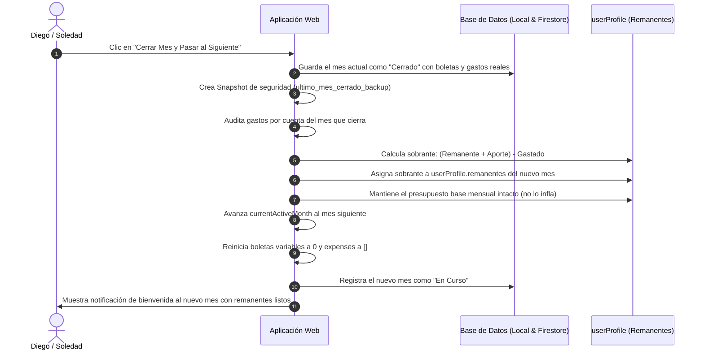

# 📋 BITÁCORA Y GUÍA DE ARQUITECTURA TÉCNICA
## Sistema de Finanzas Compartidas — Diego & Soledad (Web App PWA)

> [!IMPORTANT]
> **REGLA FUNDAMENTAL PARA CUALQUIER AGENTE DE IA O DESARROLLADOR:**
> 1. **Registro Obligatorio:** Cualquier modificación, corrección, ajuste de fórmula, adición de campos o nueva funcionalidad realizada en el proyecto **DEBE registrarse inmediatamente en esta bitácora**, al final del documento en la sección [Historial de Modificaciones](#historial-de-modificaciones), detallando la fecha, el motivo, los archivos modificados y el impacto técnico.
> 2. **Paridad Absoluta de Archivos:** `index.html` y `dashboard_pareja.html` **DEBEN ser 100% idénticos byte por byte** en todo momento. Si editas `index.html`, debes replicar exactamente el mismo contenido en `dashboard_pareja.html`.
> 3. **Incremento de Caché PWA:** Todo cambio en el código fuente debe incrementar la versión de caché en `sw.js` (ej: `finanzas-pareja-v28` -> `v29`) y la versión de consulta en el registro de `index.html` (`sw.js?v=...`) para garantizar que las apps móviles de Diego y Soledad se actualicen inmediatamente sin caché obsoleta.
> 4. **Despliegue a GitHub:** Todo cambio confirmado debe subirse a la rama `main` (`git push origin main`) para que GitHub Pages publique la versión activa.

---

## 🌐 1. Resumen y Propósito del Proyecto

Esta aplicación es una **Progressive Web App (PWA) Single Page Application (SPA)** diseñada exclusivamente para que **Diego y Soledad** administren de manera autónoma, intuitiva y 100% digital sus finanzas del hogar, eliminando la necesidad de planillas de cálculo de escritorio.

* **URL de Producción (GitHub Pages):** `https://diegofuenzalidag20-png.github.io/hogar-compartido/`
* **Tecnología:** HTML5, CSS3 Glassmorphism responsivo para móviles, JavaScript vainilla modular, Chart.js para visualización analítica.
* **Persistencia:** Almacenamiento local ultrarrápido en `localStorage` con respaldo y sincronización automática entre los teléfonos de ambos (revisión cada 15 s y al volver a la app) mediante **Firebase Firestore** (proyecto `finanzas-diego-soledad`, documento `hogar/datos_compartidos`).
* **Modo Offline:** Funciona sin conexión a internet mediante Service Worker (`sw.js`), sincronizando los cambios una vez recuperada la conectividad.

---

## 🧱 2. Arquitectura de Módulos y Pestañas

La aplicación se organiza en 4 pestañas principales accesibles desde la barra de navegación superior:

```mermaid
flowchart TD
    Nav["Barra de Navegación"]
    Nav --> Tab1["1. Control Mensual (tab-auditoria)"]
    Nav --> Tab2["2. Análisis Mes Actual (tab-mes-actual)"]
    Nav --> Tab3["3. Cuentas & Cofres (tab-cuentas)"]
    Nav --> Tab4["4. Base de Datos & Historial (tab-historico)"]

    Tab1 --> CajaRapida["Caja de Ingreso Rápido de Boletas"]
    Tab1 --> TablaAuditoria["Tabla de Compromisos y Checklist"]
    Tab1 --> TablaGastos["Tabla de Gastos Registrados en Vivo"]

    Tab2 --> KPIs["Scorecards de KPIs del Mes"]
    Tab2 --> Donas3["3 Donas por Categoría (Global, Diego, Soledad)"]
    Tab2 --> TarjetasDonas["Donas por Tarjeta / Cofre (Saldos & Consumo)"]
    Tab2 --> Comparativas["Meta vs Real, Equilibrio Pareja, Fijos vs Variables"]

    Tab3 --> SueldosCofres["Asignación de Sueldos y Cofres"]
    Tab3 --> Remanentes["Casillas de Remanente Mes Pasado"]
    Tab3 --> SmartVisa["Control Tarjeta Smart Visa BancoEstado"]

    Tab4 --> HistorialBD["Base de Datos de Meses Cerrados"]
    Tab4 --> Consolidado26["Histórico Consolidado 26+ Meses"]
```



---

### Pestaña 1: Control Mensual (`tab-auditoria`)
Es el panel operativo cotidiano de la pareja:
1. **Banner del Periodo Financiero en Curso:** Muestra el mes activo (ej: *Noviembre 2026 - Mes Abierto*).
2. **Acciones del Periodo:**
   * 💾 **Guardar en Base de Datos:** Genera una copia de seguridad del mes en curso en la BD.
   * 🚀 **Cerrar Mes y Pasar al Siguiente:** Cierra el periodo actual, audita y traslada los remanentes sobrantes al mes entrante, reinicia gastos y activa el nuevo mes.
   * 📁 **Ver Base de Datos:** Acceso directo a la pestaña de historial.
   * ↩️ **Reabrir Mes Anterior:** Si se cerró un mes por error, este botón permite restaurar el snapshot del mes cerrado.
3. **Caja de Ingreso Rápido de Boletas & Gastos:**
   * **Botones de un solo toque (Auto-relleno):** `💡 Luz`, `💧 Agua`, `🔥 Gas`, `📱 Plan Claro Sole`, `📶 Planes Entel`, `🌐 Internet Hogar`, `🥪 Snack` (Diego con Tenpo), `🛒 Supermercado`, `🏢 Gasto Común`, etc.
   * **Campos del formulario:**
     * `Fecha`: Sugiere automáticamente la **fecha del día de hoy** para agilizar el registro.
     * `¿Quién Pagó?`: Diego, Soledad o 50/50 Compartido.
     * `Categoría`: Incluye todas las categorías familiares y la opción de **"Transferencia a Tercero"**.
     * `Monto ($ CLP)`: Formateador numérico chileno.
     * `Medio de Pago`: Cuenta Fan, Tenpo Diego, Mach Diego, Mercado Pago Diego, Chequera BancoEstado, Tenpo Soledad, Smart Visa, Mercado Pago Soledad, Ahorro BancoEstado o Efectivo.
     * `Detalle / Comercio`: Nombre de la boleta o tienda.
   * **Botón ➕ REGISTRAR BOLETA / GASTO:** Agrega el gasto, recalcula los saldos y actualiza la nube.
   * **Botón 🧹 Limpiar:** Vacía **todas las casillas** del formulario para ingresar un gasto limpio.
4. **Tabla de Gastos Registrados:**
   * Muestra todos los consumos del mes ordenados cronológicamente desde el **día 1 hasta el último día del mes hacia abajo**.
   * Filtros dinámicos en un toque: `Todos`, `Solo Diego`, `Solo Soledad`.
   * Buscador en vivo por comercio/detalle y botón para exportar a CSV.

---

### Pestaña 2: Análisis Mes Actual (`tab-mes-actual`)
Brinda una radiografía financiera integral vinculada a los gastos reales:
1. **Scorecards de KPIs:**
   * Ingresos Familiares del Mes (Suma de sueldos líquidos de Diego y Soledad).
   * Total Gastos Auditados Mes (Suma de gastos en tabla).
   * Desvío vs Presupuesto Meta (Semáforo verde si está bajo la meta, amarillo/rojo si excede).
   * Superávit / Capacidad de Ahorro Libre Familiar.
2. **3 Donas de Desglose de Gastos por Categoría:**
   * **🌐 Global Familiar:** Todos los gastos consolidados.
   * **🔵 Diego:** Gastos asumidos por Diego (+50% compartido).
   * **🟣 Soledad:** Gastos cubiertos por Soledad (+50% compartido).
3. **Análisis de Gastos por Tarjeta / Cuenta (Donas Individuales):**
   * Gráficos de dona individuales para cada medio de pago:
     * Tenpo Prepago Diego, Mach Diego, Mercado Pago Diego, Cuenta Fan Banco de Chile.
     * Chequera Electrónica BancoEstado, Tenpo Soledad, Tarjeta Smart Visa, Mercado Pago Soledad, Cuenta Ahorro Reserva.
   * **Estructura unificada de 3 métricas:**
     * **Si hay remanente del mes pasado:** Muestra `Remanente Previo` + `Transferido Este Mes` = `Disponible Total`.
     * **Si no hay remanente previo:** Muestra `Transferido` - `Gastado` = `Disponible`.
     * **Para Smart Visa:** Muestra `Cupo Total`, `Deuda Actual` y `Cupo Disponible`.
   * **Desglose de categorías de Tenpo Diego:** Separa detalladamente `🚌 Pasajes Bus`, `🥪 Snacks`, `🚗 Uber`, `🚆 Metro Valparaíso`, `💡 Servicios Huasco` y `📦 Otros`.
4. **Gráficos Analíticos Complementarios:**
   * **Presupuesto Meta vs Real en Tabla:** Barras comparativas de lo planificado vs gastado por categoría.
   * **Desembolso Pareja (Diego vs Soledad):** Carga asumida por cada uno vs su saldo libre.
   * **Gastos Fijos vs Variables:** Proporción real de compromisos ineludibles vs consumo del mes.

---

### Pestaña 3: Cuentas & Cofres (`tab-cuentas`)
Define la distribución del dinero líquido al inicio de cada mes y el control de ahorros:
1. **Sueldos Líquidos Percibidos:**
   * Diego: `$1.214.038` (modificable con cálculo de horas extras).
   * Soledad: `$875.000` (modificable).
2. **Cofres de Diego (Distribución desde Cuenta Fan):**
   * `Cuenta Fan (Banco de Chile)`: Cuenta principal para gastos fijos del hogar.
   * `Tenpo Prepago Diego`: Pasajes, Uber, Metro, Turno Huasco. Incluye casilla de **Remanente mes pasado**.
   * `Mach Prepago Diego`: Bolsillo semanal ($35k/semana). Incluye casilla de **Remanente mes pasado**.
   * `Mercado Pago Diego`: Fondo de emergencia con rendimiento diario. Incluye casilla de **Remanente mes pasado**.
3. **Cofres de Soledad (Distribución desde Chequera BancoEstado):**
   * `Chequera Electrónica`: Cuenta principal para cuentas del hogar Limache (~$286k).
   * `Tarjeta Smart Visa (BancoEstado)`: Línea de crédito en cuotas. Control de Cupo Total ($500k), Cuota pagada este mes ($50k), Deuda anterior facturada, compras del mes en vivo, deuda actual y cupo disponible.
   * `Tenpo Prepago Soledad`: Bolsillo personal. Incluye casilla de **Remanente mes pasado**.
   * `Mercado Pago Soledad`: Ahorro diario remunerado. Incluye casilla de **Remanente mes pasado**.
   * `Cuenta Ahorro Reserva (BancoEstado)`: Fondo de reserva protegido. Incluye casilla de **Remanente mes pasado**.
4. **Reactividad Bidireccional:** Modificar cualquier monto en esta pestaña actualiza al instante el gráfico consolidado de cofres (`chartCofres`), guarda en `userProfile` y sincroniza las donas de [Análisis Mes Actual](file:///c:/Users/diego/OneDrive/Escritorio/Proyectos%20personales/Excel%20compartido/index.html).

---

### Pestaña 4: Base de Datos & Historial (`tab-historico`)
1. **Historial de Meses Cerrados y Guardados:** Tarjetas interactivas de cada mes cerrado con totales de ingresos, gastos, superávit y detalle de boletas.
2. **Tabla Histórica Consolidada 26+ Meses:** Historial financiero completo continuo (2024 a 2026) que integra tanto los meses reales auditados como los nuevos meses que se van cerrando en la aplicación.

---

## ⚙️ 3. Lógica del Cierre de Mes y Traspaso de Remanentes

El flujo implementado en `confirmarCierreMes()` asegura que el dinero no se confunda ni se duplique:



### Reglas de Cálculo de Remanentes:
* **Mercado Pago & Cuentas de Ahorro:**
  $$\text{Remanente Nuevo Mes} = \max(0, \text{Remanente Anterior} + \text{Aporte Mes Cerrado} - \text{Gastos Registrados})$$
* **Tarjetas Prepago Operativas (Tenpo / Mach):**
  $$\text{Remanente Nuevo Mes} = \max(0, \text{Remanente Anterior} + \text{Presupuesto Mes Cerrado} - \text{Gastos Registrados})$$
* **Tarjeta Smart Visa (Crédito):**
  $$\text{Deuda Arrastrada al Nuevo Mes} = \max(0, \text{Deuda Anterior} + \text{Compras del Mes Cerrado} - \text{Cuota Pagada})$$

---

## 🗄️ 4. Estructura de Datos en LocalStorage y Firestore

| Clave en LocalStorage | Tipo de Dato | Descripción |
| :--- | :--- | :--- |
| `finanzas_user_profile` | Objeto JSON | Perfil financiero (`diegoSalary`, `soledadSalary`, `cofresDiego`, `cofresSoledad`, `remanentes`, `smartVisaConfig`). |
| `app_active_month` | String | Nombre del mes activo actual (ej: `"Noviembre 2026"`). |
| `family_expenses` / `hogar_gastos` | Array JSON | Lista de gastos registrados del mes en curso. |
| `audit_<Mes>` | Array JSON | Lista de boletas y compromisos del mes (`currentAuditItems`). |
| `db_historial_meses` | Array JSON | Historial completo de meses guardados y cerrados. |
| `ultimo_mes_cerrado_backup` | Objeto JSON | Respaldo para poder reabrir el último mes cerrado. |
| `app_theme` | String | Preferencia de tema visual (`"light"` o ausente para dark mode). |
| `finanzas_sync_base` | Objeto JSON | Último estado acordado con la nube; permite detectar y combinar cambios de cada teléfono. |
| `finanzas_sync_update_time` | String | `updateTime` de Firestore correspondiente a esa base. |

---

## 📜 5. Historial de Modificaciones

> Esta sección es un registro acumulativo. **Cada intervención del agente de IA debe agregar una nueva entrada al inicio de esta lista.**

### [2026-11-09] — Historial Usa lo Realmente Pagado en Meses Cerrados (v38)
* **Motivo:** Oct-26 mostraba valores por defecto de las boletas en vez de lo pagado.
* **Regla de negocio:** Hasta septiembre 2026 las cuentas de consumo se guardaban con el título del mes anterior (consumo ahora, pago al mes siguiente). Octubre repite esos valores por decisión de los usuarios, y desde entonces cada gasto se registra en su mes real.
* **Solución Técnica:** `extractMonthlyBreakdown()` usa la suma de `gastosDiarios` para Luz, Agua, Gas, Plan Claro, Gasto Común y Michis cuando existen; si no hay pagos, usa la boleta. El total del mes se ajusta con la misma diferencia.
* **Archivos Modificados:** `index.html`, `dashboard_pareja.html`, `sw.js` (`finanzas-pareja-v38`), `BITACORA.md`.
* **Impacto:** El Historial refleja lo pagado, y los meses futuros quedan correctos al cerrarlos.

### [2026-11-09] — Historial Rediseñado: Evolución por Cuenta y Meses en Lista (v37)
* **Motivo:** El gráfico de servicios mezclaba cuatro líneas y la pestaña dependía de tarjetas con textos fijos y tablas anchas.
* **Solución Técnica:**
  * `renderHistoricoPanel()` genera todo desde `getConsolidatedHistoricalMonths()`: selector de cuenta, vistas En el tiempo / Por año, rango 12 meses / Todo, último valor, comparación con el año anterior, promedio, máximo y mínimo.
  * Un mes en $0 se trata como boleta sin registrar y deja de hundir la línea (`resumenCuentaHist()`).
  * "Promedio de cada cuenta" reemplaza las seis tarjetas fijas; "Meses guardados" es una lista paginada en teléfono; la tabla completa queda plegada, con lo más reciente primero y la columna Mes fija.
  * `getConsolidatedHistoricalMonths()` ordena cronológicamente; antes los meses cerrados se agregaban invertidos.
  * `aplicarCifrasVigentes()` muestra el mes en curso con datos actuales en lista y detalle.
* **Archivos Modificados:** `index.html`, `dashboard_pareja.html`, `sw.js` (`finanzas-pareja-v37`), `BITACORA.md`.
* **Impacto:** Se puede seguir la evolución de cada cuenta en una sola pantalla y comparar años.

### [2026-11-09] — Revisión Visual con Playwright: Ajustes en Teléfono, Modo Claro y Escritorio (v36)
* **Motivo:** Revisión pantalla por pantalla de la app publicada.
* **Solución Técnica:**
  * `formatCLP()` muestra `-$` en negativos y nunca `NaN`.
  * Inicio muestra primero los gastos: el co-aporte hipotecario va después y la guía parte plegada.
  * Cofres en sobregiro aparecen en rojo con su etiqueta; la leyenda de distribución ya no se corta y su total coincide con los ingresos.
  * Cada superávit indica contra qué se calcula (boletas, gastos o presupuesto).
  * Los gráficos toman colores según el tema (`chartTextColor()`, `chartBorderColor()`) y se redibujan al cambiarlo.
  * El mes en curso del historial muestra sueldos y totales vigentes.
* **Archivos Modificados:** `index.html`, `dashboard_pareja.html`, `sw.js` (`finanzas-pareja-v36`), `BITACORA.md`.
* **Impacto:** Pantallas consistentes y legibles en teléfono, modo claro y escritorio.

### [2026-11-09] — Blindaje tras Batería de 56 Escenarios, Análisis Rediseñado y Lista de Gastos Corta (v34–v35)
* **Motivo:** Reducir el scroll, simplificar los gráficos y blindar la app para el uso diario.
* **Interfaz:**
  * Lista de gastos móvil de 8 en 8 con Ver más / Ver menos (`verMasGastos()`); la búsqueda muestra todo.
  * Análisis ordenado de lo más útil a lo más detallado: indicadores con disponible por persona, semáforo, presupuesto vs real con montos (`#metaRealLista`), dona única con selector (`elegirDona()`), cofres como lista compacta (`toggleCofreDetalle()`, la dona se dibuja al abrir).
  * La pestaña Resumen pasó a "Más detalle del mes" (`#detalleResumen`); se quitó la tabla fija con cifras antiguas.
* **Fallos corregidos:**
  * Un gasto registrado durante una subida se marcaba como enviado y se perdía: `runCloudSync()` ahora copia el estado antes de subir.
  * Al abrir, cada teléfono escribía `machSemanal` y borraba el ajuste: ya no se escribe sin cambios, y `mergeThreeWay()` combina objetos campo a campo.
  * Datos de la nube ilegibles ya no reemplazan lo local; `leerJSON()` y `parseSeguro()` toleran almacenamiento corrupto, y una memoria llena no interrumpe el registro.
  * Doble toque ya no duplica gastos ni cierra dos meses; los ids son únicos entre teléfonos.
  * Editar usa el id del gasto (`editingExpenseId`), aunque la lista cambie durante la edición.
  * Borrar o editar un gasto mantiene alineada su boleta (`itemDeGasto()`).
  * Texto de usuario escapado en checklist, tarjetas y diagnóstico; el CSV escapa comillas; el sueldo no acepta $0.
* **Archivos Modificados:** `index.html`, `dashboard_pareja.html`, `sw.js` (`finanzas-pareja-v35`), `test_sync_merge.mjs`, `BITACORA.md`.
* **Impacto:** Verificado con 56 escenarios sobre una Firestore simulada: varios teléfonos, cortes de red, datos corruptos y cierres de mes.

### [2026-11-09] — Mach con Transferencia Semanal Automática según Fondos de Cuenta Fan (v33)
* **Motivo:** Mach mostraba el mes completo desde el día 1, cuando en la práctica recibe $35.000 cada lunes desde Cuenta Fan y solo si hay fondos.
* **Solución Técnica:**
  * `getMachSemanal()` recorre los lunes del mes activo y marca cada uno como transferido si Cuenta Fan tenía fondos ese día, según los gastos registrados.
  * Cuenta Fan descuenta solo lo realmente transferido; la meta del mes considera los lunes reales (`sincronizarItemMach()`).
  * En Cuentas: monto semanal, lunes con estado (`toggleMachLunes()` corrige uno a mano) y saldo real (`ajustarSaldoMach()`); un ajuste negativo se muestra como gasto "Sin registrar".
  * Al cerrar el mes pasa a remanente solo el disponible real; ajuste y excepciones se reinician.
* **Datos:** `userProfile.machSemanal` = `{ monto, ajuste, excepciones }`.
* **Archivos Modificados:** `index.html`, `dashboard_pareja.html`, `sw.js` (`finanzas-pareja-v33`), `test_cofres.mjs`, `BITACORA.md`.
* **Impacto:** El saldo de Mach refleja lo que llega cada semana y puede calzarse con el banco.

### [2026-11-09] — Meta sin Gastos Sueltos, Botones del Período al Menú y Panel Central de Sueldos (v32)
* **Motivo:** La meta subía con cada gasto sin boleta conocida; los botones del período y los sueldos ocupaban espacio o quedaban perdidos en el teléfono.
* **Solución Técnica:**
  * `handleQuickBillSubmit()` crea el ítem del gasto con `base: 0` y `fromQuickBill: true`; `quitarGastosDelPresupuesto()` corrige los ítems antiguos, respetando los creados a mano (`custom_audit_items`).
  * `confirmarCierreMes()` ya no arrastra gastos sueltos al mes siguiente, y la lista de ítems manuales no los incluye.
  * En teléfono, los botones Guardar, Cerrar mes, Ver Base de Datos y Reabrir pasan al menú ☰; en escritorio siguen en su lugar.
  * Tarjeta `#salaryCentralCard` al inicio de Cuentas con los sueldos de ambos, total del hogar y acceso a horas extras; las casillas se movieron, no se duplicaron.
  * **Corrección crítica de sincronización:** `#audit-month-select` nacía en `Oct-26`, así que al abrir se cargaba `audit_Oct-26` y, con la detección de cambios de v29, esa copia vieja se subía sobre el mes activo. Ahora el selector se ajusta antes de cargar y tras cerrar o reabrir el mes, y `buildCompleteFamilyPayload()` sube siempre las boletas del mes activo aunque se esté mirando un mes antiguo.
* **Archivos Modificados:** `index.html`, `dashboard_pareja.html`, `sw.js` (`finanzas-pareja-v32`), `test_cofres.mjs`, `BITACORA.md`.
* **Impacto:** La meta refleja el plan del mes y Cuentas parte por los sueldos. Verificado con pruebas y escenarios en la app con Firestore interceptado.

### [2026-11-09] — Cofres: Corrección de Fallos y Cifras Únicas de Disponible y Meta (v31)
* **Motivo:** Revisión de cofres: varios errores al usar $0 y pantallas con cifras contradictorias por valores fijos en el código.
* **Solución Técnica:**
  * `readMoney()` y `??`: un cofre, deuda o aporte en $0 ahora se respeta al guardar y al cerrar el mes.
  * El sueldo editado en Cuentas persiste al recargar; asignar más que el sueldo muestra un aviso.
  * Eliminada `repararRemanentesSiEsNecesario()`, que revivía remanentes en cero.
  * `getCuentaPrincipalDisponible()`: un solo disponible por persona (fondos de Cuenta Fan o Chequera menos gastos registrados) en Inicio, Cuentas, Resumen y gráficos.
  * `getMetaMensual()`: una sola meta, la suma de los compromisos. Se eliminaron los valores fijos 609.360, 286.000, 909.360 y 1.462.750.
  * Cuota Smart Visa (`getSmartCuotaPagada()`): si está registrada como gasto se usa ese monto y no se reserva además en la Chequera.
  * `renderExpenses()` ahora sincroniza primero perfil → casillas, para que el cierre y los datos remotos no se pisen con casillas antiguas. `renderCardAnalysis()` se agrupa para no redibujar de más.
  * `renderAuditTable()` ya no se detiene al faltar la tabla antigua: los indicadores de Inicio eran texto fijo.
* **Regla confirmada:** los $365.000 de Diego se registran como gasto de Cuenta Fan y la Chequera solo asume el diferencial UF, por lo que no deben sumarse a sus fondos.
* **Archivos Modificados:** `index.html`, `dashboard_pareja.html`, `sw.js` (`finanzas-pareja-v31`), `test_cofres.mjs` (nuevo), `BITACORA.md`.
* **Impacto:** Cada persona ve la misma cifra en todas las pantallas. Verificado con `node test_cofres.mjs` y escenarios en la app con Firestore interceptado.

### [2026-11-09] — Navegación Móvil: Barra Inferior, Cabecera Compacta y Registro con Deshacer (v30)
* **Motivo:** En el teléfono las pestañas se perdían al desplazarse, la cabecera ocupaba 326 px y registrar un gasto exigía bajar más de 2 pantallas sin confirmación clara.
* **Solución Técnica (solo bajo 768 px; escritorio sin cambios):**
  * Barra inferior fija con Inicio, Análisis, Registrar (+), Cuentas e Historial. `goToTab()` y `switchTab()` mantienen el estado activo y vuelven arriba al cambiar de sección.
  * Cabecera de 63 px con menú ☰ (`toggleAppMenu()`): Resumen general, Sincronización, Guía de uso, Instalar app y Cambiar tema.
  * `#quickBillCard` se abre como hoja inferior (`openQuickSheet()`, `placeQuickCard()`), con accesos rápidos en una fila deslizable.
  * Campos a 16 px para evitar el zoom de iPhone.
* **En todas las pantallas:**
  * Los accesos rápidos ya no rellenan el monto: lo muestran como sugerencia y dejan el cursor en el campo.
  * `showToast()` admite una acción; tras registrar muestra el gasto y **Deshacer** (`undoQuickBill()`), que revierte también la boleta asociada.
* **Archivos Modificados:** `index.html`, `dashboard_pareja.html`, `sw.js` (`finanzas-pareja-v30`), `BITACORA.md`.
* **Impacto:** Navegar y registrar quedan a un toque desde cualquier punto. Verificado con toques emulados en 390×844, modo claro y escritorio, con Firestore interceptado.

### [2026-11-09] — Causa Raíz: Service Worker Cacheaba Firestore, Rescate de Gastos Locales y Errores de Gráficos (v29)
* **Motivo:** Pruebas contra Firestore real, recuperar gastos no subidos y eliminar errores de consola `Canvas is already in use`.
* **Causa raíz encontrada:** `sw.js` aplicaba Cache-First también a las lecturas de Firestore. Con el Service Worker activo, cada teléfono leía siempre una copia antigua del documento, no veía los cambios del otro y subía encima su estado completo.
* **Solución Técnica:**
  * `sw.js` ya no intercepta peticiones que no sean GET ni las dirigidas a `firestore.googleapis.com`.
  * `firstRunBase()`: al primer arranque de esta versión se rescatan y suben los gastos del mes activo que solo existen en ese teléfono, sin duplicar los que ya estén en la nube por `id` o por fecha, monto y detalle.
  * `renderCardAnalysis()` destruye el gráfico anterior del canvas con `Chart.getChart()` antes de dibujar.
  * Reglas de Firestore publicadas: acceso limitado a `hogar/datos_compartidos`, sin expiración (otras rutas responden 403).
* **Archivos Modificados:** `sw.js`, `index.html`, `dashboard_pareja.html`, `test_sync_merge.mjs`, `BITACORA.md`.
* **Impacto:** Verificado con dos móviles emulados y la app completa con Service Worker activo contra Firestore real; el documento se respaldó antes y quedó restaurado. Falta confirmar en los teléfonos reales de Diego y Soledad tras publicar.

### [2026-11-09] — Sincronización Confiable con Firestore: Combinación entre Teléfonos y Reintentos (v29)
* **Motivo:** El guardado en Firebase era intermitente: a veces funcionaba solo y otras no guardaba ni con el botón.
* **Causas encontradas:**
  1. `guardarMesEnBD()` guardaba solo en el teléfono y mostraba éxito sin subir a la nube.
  2. Cada teléfono subía su estado completo: uno desactualizado borraba lo registrado por el otro.
  3. Una subida fallida no se reintentaba, marcaba la versión local como subida y el error quedaba oculto.
  4. Los autoguardados de cofres y Smart Visa no subían a la nube.
  5. `renderExpenses()` leía casillas antiguas y pisaba la configuración de Smart Visa recién recibida.
* **Solución Técnica:**
  * Nuevo motor `syncWithCloud()` / `runCloudSync()`: compara con la última base acordada y combina por registro con `mergeThreeWay()` (gastos e ítems por `id`, meses por `nombre`, perfil por campo).
  * Escritura condicionada a `currentDocument.updateTime`: si otro teléfono guardó antes, se vuelve a leer y combinar.
  * Reintento automático cada 15 s, al recuperar conexión y al volver a la app; lo pendiente sobrevive a un reinicio.
  * Subida inmediata al salir de la app; el botón Guardar en Base de Datos ahora sube a la nube e informa el resultado real.
  * La insignia muestra `⚠️ Sin guardar en nube` cuando falla. `syncProfileToInputs()` ahora corre antes de los renderizados.
  * Caché `finanzas-pareja-v29` y registro `sw.js?v=29`. Se corrigió en esta bitácora el ID del proyecto Firestore.
* **Archivos Modificados:** `index.html`, `dashboard_pareja.html`, `sw.js`, `BITACORA.md`, `test_sync_merge.mjs` (nuevo).
* **Impacto:** Los gastos de Diego y Soledad ya no se pisan entre sí y un guardado fallido queda visible y se reintenta. Verificado con `node test_sync_merge.mjs` y simulando dos teléfonos contra una Firestore en memoria.

### [2026-11-06] — Limpieza de la Carpeta del Proyecto y Exclusión de graphify-out
* **Motivo:** Solicitud del usuario para eliminar archivos sin uso u obsoletos y evitar versionar el grafo del proyecto, que contiene copias en texto de datos financieros.
* **Solución Técnica:**
  * Se agregó `graphify-out/` a `.gitignore`.
  * Se enviaron a la Papelera de reciclaje: `scratch/`, `__pycache__/`, `gcm-diagnose.log`, `app-icon.png`, `Plan_Financiero_Compartido_Diego_Soledad_Premium_Redisenado.xlsx`, `Plan_Financiero_Compartido_Diego_Pareja.xlsx` y `fix_title.py`.
* **Archivos Modificados:** `.gitignore`, `BITACORA.md` y los archivos eliminados indicados arriba.
* **Impacto:** Sin cambios en la app: no se modificó HTML, JS ni CSS, por lo que no corresponde subir la versión de caché. `generate_sheets.py` vuelve a crear el Excel `_Redisenado` si se ejecuta.

### [2026-11-02] — Creación de Bitácora Oficial y Resumen de Estado Integral
* **Motivo:** Solicitud del usuario para documentar detalladamente el estado actual del proyecto, la arquitectura funcional y establecer la directriz de registro continuo para futuras sesiones de IA.
* **Archivos Creados / Modificados:**
  * `BITACORA.md` (Archivo creado con documentación completa del sistema).
* **Impacto:** Cualquier agente de IA que inicie una sesión podrá comprender de inmediato las reglas de negocio, la paridad de archivos, el esquema de datos y continuar trabajando sin reiniciar contexto.

### [2026-11-01] — Sincronización en Vivo de Cofres Soledad, Casillas de Remanente Universal y Rollover al Cerrar Mes (v28)
* **Motivo:**
  1. Desconexión en las donas de Soledad al modificar sus cofres en `tab-cuentas`.
  2. Falta de casillas de remanente mes pasado en Tenpo Diego, Mach y Tenpo Soledad.
  3. Al cerrar el mes, el saldo total acumulado de las cuentas se asignaba incorrectamente como un nuevo aporte mensual en lugar de trasladarse al remanente.
* **Solución Técnica:**
  * Se añadieron casillas de `Remanente mes pasado` y `Total Fondos Disponibles` en **Tenpo Diego, Mach Diego y Tenpo Soledad**.
  * Se conectó `updateSoleMargenDisplay()` e `updateSmartVisaDisplay()` con auto-guardado en `userProfile` y sincronización en vivo a `renderCardAnalysis()`.
  * Se integró la cuota mensual de Smart Visa ($50.000) en el total de transferencias de la Chequera de Soledad.
  * Se rediseñó `confirmarCierreMes()` para calcular los saldos sobrantes reales y asignarlos a `userProfile.remanentes` del nuevo mes, manteniendo intacto el presupuesto base de transferencia.
  * Se incorporó la función de auto-recuperación `repararRemanentesSiEsNecesario()`.
  * Incremento de caché en `sw.js` a `finanzas-pareja-v28`.
* **Archivos Modificados:** `index.html`, `dashboard_pareja.html`, `sw.js`.

### [2026-11-01] — Sincronización en la Nube del Mes Activo entre Dispositivos
* **Motivo:** Al cerrar el mes en un dispositivo, el teléfono de la pareja continuaba mostrando el mes anterior.
* **Solución Técnica:**
  * Se integró la clave `activeMonth` en la sincronización continua de Firestore (`hogar-compartido-sync`).
  * Se implementó auto-adopción local del mes activo al recibir datos remotos (`sincronizarMesActivoConBD`).
* **Archivos Modificados:** `index.html`, `dashboard_pareja.html`.

### [2026-10-31] — Corrección del Histórico de la Base de Datos y Reaparición de Octubre 2026
* **Motivo:** Al cerrar mes aparecían dos Octubres en la BD y faltaba Noviembre 2026; los datos cerrados no se reflejaban en la tabla consolidada histórica.
* **Solución Técnica:**
  * Corrección de la deduplicación de meses en `guardarMesEnBD()` y `asegurarMesActivoEnBD()`.
  * Renderizado dinámico de la tabla histórica continua de 26+ meses incorporando los meses cerrados en vivo.
  * Botón persistente `↩️ Reabrir Octubre 2026` para deshacer el cierre si se requería auditoría adicional.
* **Archivos Modificados:** `index.html`, `dashboard_pareja.html`.

### [2026-10-30] — Validación de Costos Fijos vs Variables, Smart Visa y Mejoras en Caja Rápida
* **Motivo:** Solicitud para revisar cálculo de fijos vs variables, botón limpiar en caja rápida, sugerencia de fecha actual y donas especializadas por categoría para Tenpo.
* **Solución Técnica:**
  * Corrección de la categorización de `isExpenseFijo` para boletas obligatorias vs consumo variable.
  * Función `limpiarCajaRapida()` mejorada para resetear fecha, pagador, categoría, monto, medio de pago y detalle.
  * Auto-relleno de la fecha de hoy (`getLocalDateISO()`).
  * Sub-categorización por texto de consumos en Tenpo Diego (`Pasajes Bus`, `Snacks`, `Uber`, `Metro Valparaíso`, `Servicios Huasco`).
* **Archivos Modificados:** `index.html`, `dashboard_pareja.html`.

### [2026-10-30] — Botón Rápido "Snack" y Categoría "Transferencia a Tercero"
* **Motivo:** Reemplazar botón rápido de Hipotecario Diego por "Snack" (Diego con Tenpo) y añadir la categoría "Transferencia a Tercero".
* **Solución Técnica:**
  * Actualización de los chips de auto-relleno y las opciones de `<select id="quickCategory">` y modales.
  * Ordenamiento cronológico de la tabla de gastos en vivo por fecha ascendente (del 1 al último día del mes en curso).
* **Archivos Modificados:** `index.html`, `dashboard_pareja.html`.

---

## 📌 6. Plantilla para Futuros Registros en la Bitácora

Cada vez que se realice una modificación en el proyecto, copiar y completar el siguiente bloque en la sección de [Historial de Modificaciones](#historial-de-modificaciones):

```markdown
### [AAAA-MM-DD] — Título Breve de la Modificación
* **Motivo:** [¿Por qué se solicitó o qué problema resolvía?]
* **Solución Técnica:** [¿Qué funciones, cálculos, estilos o eventos se modificaron?]
* **Archivos Modificados:** `index.html`, `dashboard_pareja.html`, `sw.js` (u otros según corresponda).
* **Impacto:** [¿Cómo beneficia o cambia el funcionamiento para Diego y Soledad?]
```

