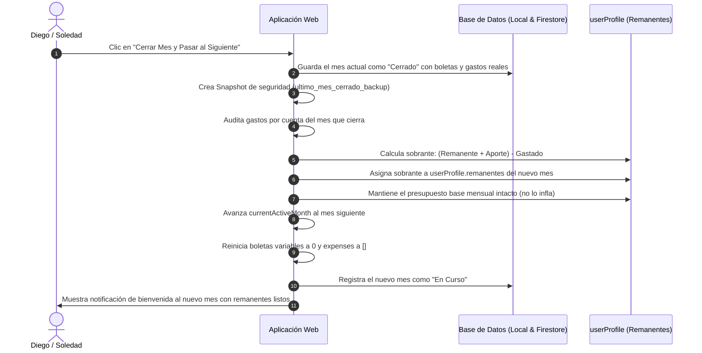

# 📋 BITÁCORA Y GUÍA DE ARQUITECTURA TÉCNICA
## Sistema de Finanzas Compartidas — Diego & Soledad (Web App PWA)

> [!IMPORTANT]
> **REGLA FUNDAMENTAL PARA CUALQUIER AGENTE DE IA O DESARROLLADOR:**
> 1. **Registro Obligatorio:** Cualquier modificación, corrección, ajuste de fórmula, adición de campos o nueva funcionalidad realizada en el proyecto **DEBE registrarse inmediatamente en esta bitácora**, al final del documento en la sección [Historial de Modificaciones](#historial-de-modificaciones), detallando la fecha, el motivo, los archivos modificados y el impacto técnico.
> 2. **Paridad Absoluta de Archivos:** `index.html` y `dashboard_pareja.html` **DEBEN ser 100% idénticos byte por byte** en todo momento. Si editas `index.html`, debes replicar exactamente el mismo contenido en `dashboard_pareja.html`.
> 3. **Incremento de Caché PWA:** Todo cambio en el código fuente debe incrementar la versión de caché en `sw.js` (ej: `finanzas-pareja-v28` -> `v29`) y la versión de consulta en el registro de `index.html` (`sw.js?v=...`) para garantizar que las apps móviles de Diego y Soledad se actualicen inmediatamente sin caché obsoleta.
> 4. **Despliegue a GitHub:** Todo cambio confirmado debe subirse a la rama `main` (`git push origin main`) para que GitHub Pages publique la versión activa.

---

## 🌐 1. Resumen y Propósito del Proyecto

Esta aplicación es una **Progressive Web App (PWA) Single Page Application (SPA)** diseñada exclusivamente para que **Diego y Soledad** administren de manera autónoma, intuitiva y 100% digital sus finanzas del hogar, eliminando la necesidad de planillas de cálculo de escritorio.

* **URL de Producción (GitHub Pages):** `https://diegofuenzalidag20-png.github.io/hogar-compartido/`
* **Tecnología:** HTML5, CSS3 Glassmorphism responsivo para móviles, JavaScript vainilla modular, Chart.js para visualización analítica.
* **Persistencia:** Almacenamiento local ultrarrápido en `localStorage` con respaldo y sincronización automática entre los teléfonos de ambos (revisión cada 15 s y al volver a la app) mediante **Firebase Firestore** (proyecto `finanzas-diego-soledad`, documento `hogar/datos_compartidos`).
* **Modo Offline:** Funciona sin conexión a internet mediante Service Worker (`sw.js`), sincronizando los cambios una vez recuperada la conectividad.

---

## 🧱 2. Arquitectura de Módulos y Pestañas

La aplicación se organiza en 4 pestañas principales accesibles desde la barra de navegación superior:

```mermaid
flowchart TD
    Nav["Barra de Navegación"]
    Nav --> Tab1["1. Control Mensual (tab-auditoria)"]
    Nav --> Tab2["2. Análisis Mes Actual (tab-mes-actual)"]
    Nav --> Tab3["3. Cuentas & Cofres (tab-cuentas)"]
    Nav --> Tab4["4. Base de Datos & Historial (tab-historico)"]

    Tab1 --> CajaRapida["Caja de Ingreso Rápido de Boletas"]
    Tab1 --> TablaAuditoria["Tabla de Compromisos y Checklist"]
    Tab1 --> TablaGastos["Tabla de Gastos Registrados en Vivo"]

    Tab2 --> KPIs["Scorecards de KPIs del Mes"]
    Tab2 --> Donas3["3 Donas por Categoría (Global, Diego, Soledad)"]
    Tab2 --> TarjetasDonas["Donas por Tarjeta / Cofre (Saldos & Consumo)"]
    Tab2 --> Comparativas["Meta vs Real, Equilibrio Pareja, Fijos vs Variables"]

    Tab3 --> SueldosCofres["Asignación de Sueldos y Cofres"]
    Tab3 --> Remanentes["Casillas de Remanente Mes Pasado"]
    Tab3 --> SmartVisa["Control Tarjeta Smart Visa BancoEstado"]

    Tab4 --> HistorialBD["Base de Datos de Meses Cerrados"]
    Tab4 --> Consolidado26["Histórico Consolidado 26+ Meses"]
```



---

### Pestaña 1: Control Mensual (`tab-auditoria`)
Es el panel operativo cotidiano de la pareja:
1. **Banner del Periodo Financiero en Curso:** Muestra el mes activo (ej: *Noviembre 2026 - Mes Abierto*).
2. **Acciones del Periodo:**
   * 💾 **Guardar en Base de Datos:** Genera una copia de seguridad del mes en curso en la BD.
   * 🚀 **Cerrar Mes y Pasar al Siguiente:** Cierra el periodo actual, audita y traslada los remanentes sobrantes al mes entrante, reinicia gastos y activa el nuevo mes.
   * 📁 **Ver Base de Datos:** Acceso directo a la pestaña de historial.
   * ↩️ **Reabrir Mes Anterior:** Si se cerró un mes por error, este botón permite restaurar el snapshot del mes cerrado.
3. **Caja de Ingreso Rápido de Boletas & Gastos:**
   * **Botones de un solo toque (Auto-relleno):** `💡 Luz`, `💧 Agua`, `🔥 Gas`, `📱 Plan Claro Sole`, `📶 Planes Entel`, `🌐 Internet Hogar`, `🥪 Snack` (Diego con Tenpo), `🛒 Supermercado`, `🏢 Gasto Común`, etc.
   * **Campos del formulario:**
     * `Fecha`: Sugiere automáticamente la **fecha del día de hoy** para agilizar el registro.
     * `¿Quién Pagó?`: Diego, Soledad o 50/50 Compartido.
     * `Categoría`: Incluye todas las categorías familiares y la opción de **"Transferencia a Tercero"**.
     * `Monto ($ CLP)`: Formateador numérico chileno.
     * `Medio de Pago`: Cuenta Fan, Tenpo Diego, Mach Diego, Mercado Pago Diego, Chequera BancoEstado, Tenpo Soledad, Smart Visa, Mercado Pago Soledad, Ahorro BancoEstado o Efectivo.
     * `Detalle / Comercio`: Nombre de la boleta o tienda.
   * **Botón ➕ REGISTRAR BOLETA / GASTO:** Agrega el gasto, recalcula los saldos y actualiza la nube.
   * **Botón 🧹 Limpiar:** Vacía **todas las casillas** del formulario para ingresar un gasto limpio.
4. **Tabla de Gastos Registrados:**
   * Muestra todos los consumos del mes ordenados cronológicamente desde el **día 1 hasta el último día del mes hacia abajo**.
   * Filtros dinámicos en un toque: `Todos`, `Solo Diego`, `Solo Soledad`.
   * Buscador en vivo por comercio/detalle y botón para exportar a CSV.
   * **Proyección de fin de mes (v82, solo en el mes en curso):** "A este ritmo terminan el mes en $X" bajo los totales, comparada con la meta del mes y los ingresos del hogar (verde bajo la meta, ámbar si la pasa, rojo si pasa los ingresos). Ver `proyeccionFinDeMes()`.

---

### Pestaña 2: Análisis Mes Actual (`tab-mes-actual`)
Brinda una radiografía financiera integral vinculada a los gastos reales:
1. **Scorecards de KPIs:**
   * Ingresos Familiares del Mes (Suma de sueldos líquidos de Diego y Soledad).
   * Total Gastos Auditados Mes (Suma de gastos en tabla).
   * Desvío vs Presupuesto Meta (Semáforo verde si está bajo la meta, amarillo/rojo si excede).
   * Superávit / Capacidad de Ahorro Libre Familiar.
2. **3 Donas de Desglose de Gastos por Categoría:**
   * **🌐 Global Familiar:** Todos los gastos consolidados.
   * **🔵 Diego:** Gastos asumidos por Diego (+50% compartido).
   * **🟣 Soledad:** Gastos cubiertos por Soledad (+50% compartido).
3. **Análisis de Gastos por Tarjeta / Cuenta (Donas Individuales):**
   * Gráficos de dona individuales para cada medio de pago:
     * Tenpo Prepago Diego, Mach Diego, Mercado Pago Diego, Cuenta Fan Banco de Chile.
     * Chequera Electrónica BancoEstado, Tenpo Soledad, Tarjeta Smart Visa, Mercado Pago Soledad, Cuenta Ahorro Reserva.
   * **Estructura unificada de 3 métricas:**
     * **Si hay remanente del mes pasado:** Muestra `Remanente Previo` + `Transferido Este Mes` = `Disponible Total`.
     * **Si no hay remanente previo:** Muestra `Transferido` - `Gastado` = `Disponible`.
     * **Para Smart Visa:** Muestra `Cupo Total`, `Deuda Actual` y `Cupo Disponible`.
   * **Desglose de categorías de Tenpo Diego:** Separa detalladamente `🚌 Pasajes Bus`, `🥪 Snacks`, `🚗 Uber`, `🚆 Metro Valparaíso`, `💡 Servicios Huasco` y `📦 Otros`.
4. **Gráficos Analíticos Complementarios:**
   * **Presupuesto Meta vs Real en Tabla:** Barras comparativas de lo planificado vs gastado por categoría.
   * **Desembolso Pareja (Diego vs Soledad):** Carga asumida por cada uno vs su saldo libre.
   * **Gastos Fijos vs Variables:** Proporción real de compromisos ineludibles vs consumo del mes.

---

### Pestaña 3: Cuentas & Cofres (`tab-cuentas`)
Define la distribución del dinero líquido al inicio de cada mes y el control de ahorros:
1. **Sueldos Líquidos Percibidos:**
   * Diego: `$1.214.038` (modificable con cálculo de horas extras).
   * Soledad: `$875.000` (modificable).
2. **Cofres de Diego (Distribución desde Cuenta Fan):**
   * `Cuenta Fan (Banco de Chile)`: Cuenta principal para gastos fijos del hogar.
   * `Tenpo Prepago Diego`: Pasajes, Uber, Metro, Turno Huasco. Incluye casilla de **Remanente mes pasado**.
   * `Mach Prepago Diego`: Bolsillo semanal ($35k/semana). Incluye casilla de **Remanente mes pasado**.
   * `Mercado Pago Diego`: Fondo de emergencia con rendimiento diario. Incluye casilla de **Remanente mes pasado**.
   * `Tarjeta de Crédito BCI (Mastercard)`: Control de Cupo Total ($900k), **Pago este mes**, Deuda anterior facturada, compras del mes en vivo, deuda actual y cupo disponible. Las compras con la tarjeta ya son gasto del mes en que se hacen; el pago **no es un gasto**: se aparta de la cuenta principal (baja su remanente como una transferencia a un cofre) y solo baja la deuda.
3. **Cofres de Soledad (Distribución desde Chequera BancoEstado):**
   * `Chequera Electrónica`: Cuenta principal para cuentas del hogar Limache (~$286k).
   * `Tarjeta Smart Visa (BancoEstado)`: Línea de crédito en cuotas. Control de Cupo Total ($500k), **Cuota deuda antigua (este mes)** ($50k; paga la deuda anterior a la app y cuenta como gasto/compromiso), **Pago de compras nuevas** (las compras con la tarjeta ya son gasto al comprar; su pago **no es un gasto**: se aparta de la Chequera y solo baja la deuda), Deuda anterior facturada, compras del mes en vivo, deuda actual y cupo disponible.
   * `Tenpo Prepago Soledad`: Bolsillo personal. Incluye casilla de **Remanente mes pasado**.
   * `Mercado Pago Soledad`: Ahorro diario remunerado. Incluye casilla de **Remanente mes pasado**.
   * `Cuenta Ahorro Reserva (BancoEstado)`: Fondo de reserva protegido. Incluye casilla de **Remanente mes pasado**.
4. **Reactividad Bidireccional:** Modificar cualquier monto en esta pestaña actualiza al instante el gráfico consolidado de cofres (`chartCofres`), guarda en `userProfile` y sincroniza las donas de [Análisis Mes Actual](file:///c:/Users/diego/OneDrive/Escritorio/Proyectos%20personales/Excel%20compartido/index.html).
5. **🔁 Traspasos entre mis cuentas (v82):** tarjeta con un mini formulario (fecha, desde, hacia, monto, detalle) y la lista del mes. Mueve plata entre cuentas propias sin contarla como gasto: la cuenta de origen baja y la de destino sube (cofres, liquidez, disponible de la cuenta principal, Mach y remanentes del cierre). Las tarjetas de crédito no participan (su pago ya tiene su campo).

---

### Pestaña 4: Base de Datos & Historial (`tab-historico`)
1. **Historial de Meses Cerrados y Guardados:** Tarjetas interactivas de cada mes cerrado con totales de ingresos, gastos, superávit y detalle de boletas.
2. **Tabla Histórica Consolidada 26+ Meses:** Historial financiero completo continuo (2024 a 2026) que integra tanto los meses reales auditados como los nuevos meses que se van cerrando en la aplicación.

---

## ⚙️ 3. Lógica del Cierre de Mes y Traspaso de Remanentes

El flujo implementado en `confirmarCierreMes()` asegura que el dinero no se confunda ni se duplique:



### Reglas de Cálculo de Remanentes:
* **Traspasos entre cuentas propias (v82):** el neto de cada cuenta (entradas − salidas, `netoTraspasos`) se suma a lo disponible antes de calcular el remanente; no son gasto. La lista del mes se guarda en el registro del mes cerrado y el mes nuevo parte sin traspasos. Cuenta Fan/BCI y Chequera siguen partiendo en $0.
* **Mercado Pago & Cuentas de Ahorro:**
  $$\text{Remanente Nuevo Mes} = \max(0, \text{Remanente Anterior} + \text{Aporte Mes Cerrado} - \text{Gastos Registrados})$$
* **Tarjetas Prepago Operativas (Tenpo / Mach):**
  $$\text{Remanente Nuevo Mes} = \max(0, \text{Remanente Anterior} + \text{Presupuesto Mes Cerrado} - \text{Gastos Registrados})$$
* **Tarjeta Smart Visa (Crédito):**
  $$\text{Deuda Arrastrada al Nuevo Mes} = \max(0, \text{Deuda Anterior} + \text{Compras del Mes Cerrado} - \text{Cuota Pagada} - \text{Pago de Compras Nuevas})$$
  Al cerrar, `smartVisaConfig.pagoCompras` vuelve a 0.
* **Tarjeta de Crédito BCI (Diego):** misma fórmula con `Pago este mes` en lugar de la cuota; al cerrar, `tcBciConfig.pagoMes` vuelve a 0 (cada estado de cuenta es distinto) y el cupo se conserva.

---

## 🗄️ 4. Estructura de Datos en LocalStorage y Firestore

| Clave en LocalStorage | Tipo de Dato | Descripción |
| :--- | :--- | :--- |
| `finanzas_user_profile` | Objeto JSON | Perfil financiero (`diegoSalary`, `soledadSalary`, `cofresDiego`, `cofresSoledad`, `remanentes`, `smartVisaConfig`, `tcBciConfig`). |
| `app_active_month` | String | Nombre del mes activo actual (ej: `"Noviembre 2026"`). |
| `family_expenses` / `hogar_gastos` | Array JSON | Lista de gastos registrados del mes en curso. |
| `family_traspasos` | Array JSON | Traspasos entre cuentas propias del mes en curso (`{id, date, from, to, amount, desc?, autor?}`). No son gasto. Se sincronizan como sección `traspasos` del documento de la nube y se guardan con cada mes en `db_historial_meses[].traspasos`. |
| `audit_<Mes>` | Array JSON | Lista de boletas y compromisos del mes (`currentAuditItems`). |
| `db_historial_meses` | Array JSON | Historial completo de meses guardados y cerrados. |
| `ultimo_mes_cerrado_backup` | Objeto JSON | Respaldo para poder reabrir el último mes cerrado. |
| `app_theme` | String | Preferencia de tema visual (`"light"` o ausente para dark mode). |
| `finanzas_sync_base` | Objeto JSON | Último estado acordado con la nube; permite detectar y combinar cambios de cada teléfono. |
| `finanzas_sync_update_time` | String | `updateTime` de Firestore correspondiente a esa base. |

---

## 📜 5. Historial de Modificaciones

> Esta sección es un registro acumulativo. **Cada intervención del agente de IA debe agregar una nueva entrada al inicio de esta lista.**

### [2026-11-20] — Traspasos entre cuentas propias (no son gasto), proyección de fin de mes y plantilla de presupuesto (v82)
* **Motivo:** (A) Pasar plata entre cuentas propias (p. ej. Mach → BCI Cuenta Corriente) se registraba como gasto ("Transferencia a Tercero"): inflaba el total del mes, creaba ítems sueltos en el presupuesto y movía los gráficos. (B) Faltaba ver cómo termina el mes al ritmo actual. (C) Valores de la plantilla de presupuesto que ya no calzan con lo que se paga.
* **A) Traspasos — modelo de datos (decisión):** lista **separada** `traspasos` = `[{ id, date, from, to, amount, desc?, autor? }]` (`from`/`to` son los valores del medio de pago, los mismos del formulario de gastos; `autor` = dueño de la cuenta de origen, porque la app no sabe quién tiene el teléfono). Vive en el mismo documento de la nube (`appStateJson.traspasos`) y en `localStorage` (`family_traspasos`). Entra a `SYNC_SECTIONS` con clave `id`, así que se combina a tres vías con el mismo mecanismo que `expenses` (un traspaso creado en un teléfono y un borrado en el otro no se pisan). Por qué no dentro de `expenses` con `tipo: 'traspaso'`: había que excluirlo en cada uno de los ~29 recorridos de `expenses` (totales, gráficos, presupuesto, checklist, historial, CSV) y un teléfono con la app antigua lo sumaría como gasto; con una lista aparte ningún total puede contarlo por error y la combinación solo necesitó sumar la sección (más los dos resguardos de abajo).
  * `js/08-nube.js`: `let traspasos`; `SYNC_SECTIONS` suma `traspasos: 'id'`; `applyRemoteDataToApp` aplica la lista solo si viene (un teléfono o respaldo anterior sin ella no la borra); `mergeThreeWay` trata una sección ausente del lado remoto como "sin cambios" (una versión anterior no manda `traspasos` y su ausencia no es un borrado); `firstRunBase` rescata los traspasos locales que la nube no tiene; `restaurarRespaldo` aplica `{ traspasos: [], ...payload }` (un respaldo de antes de los traspasos los deja en cero, como pide el aviso "lo registrado después se pierde").
  * `js/07-pwa-enlace.js`: `buildCompleteFamilyPayload` incluye `traspasos`, por lo que entran al respaldo diario, al respaldo JSON, al enlace de WhatsApp y al VPS; importar un JSON o un enlace sin la lista no la toca.
  * Por mes igual que los gastos (`js/11-historial-cierre.js`): `guardarMesEnBD` y `asegurarMesActivoEnBD` guardan `traspasos` en el registro del mes; `confirmarCierreMes` los guarda en `ultimo_mes_cerrado_backup`, vacía la lista del mes nuevo y calcula los remanentes con ellos; `deshacerUltimoCierreMes` los restaura; `verDetalleMes` los muestra aparte ("no son gasto").
  * Saldos — `netoTraspasos(key, antesDe?)` en `js/14-tarjetas.js` = entradas − salidas de una cuenta usando `normalizeAccountKey` sobre `to`/`from` (la cuenta corriente BCI es el fondo principal de Diego, igual que la Fan; `antesDe` cuenta solo los de días anteriores). Se aplica en: `getCuentaPrincipalDisponible`; `getLiquidezPersona` (por cuenta: dentro de una persona suma cero, entre personas mueve liquidez; no cuenta como plata usada); `getMachSemanal` (`disponible`, y el saldo de Fan antes de cada lunes: un traspaso que saca plata de Fan antes del lunes cuenta como salida y puede dejar a Mach sin su transferencia automática; uno que entra a Fan la devuelve); la tarjeta de cada cuenta en Análisis (se suma al fondo y aparece "Traspasos: ±$X" en su cabecera; el crédito no recibe); los totales de cofres en Cuentas (`js/03-perfil-cofres.js`: Tenpo, Mach y Mercado Pago de Diego; Tenpo, Mercado Pago y Reserva de Soledad); y los remanentes que pasan al mes siguiente al cerrar (Tenpo, Mercado Pago, Reserva; Mach por su `disponible`; Fan y Chequera siguen partiendo en $0).
  * Listas de origen y destino: cuentas de Diego y Soledad del formulario de gastos sin las tarjetas de crédito (Smart Visa y tarjeta BCI ya tienen su campo de pago) y sin "Otros" (efectivo y otras tarjetas no tienen saldo en la app, y una transferencia a un tercero sigue siendo gasto).
  * UI — `js/16-traspasos.js` (módulo nuevo) y `index.html`/`dashboard_pareja.html`: tarjeta "Traspasos entre mis cuentas" al comienzo de Cuentas (fecha de hoy por defecto, desde, hacia, monto, detalle opcional y "Registrar traspaso") con la lista del mes y botón de borrar. Valida con `avisar` (cuentas distintas, monto mayor a $0), borra con `confirmar`, usa los mismos resguardos que un gasto (`versionBloqueada`/`avisarVersionAntigua`, `recargarSiOtraCopiaSincronizo`) y sube con `triggerAutoSyncToCloud(true)`; el aviso al registrar trae "Deshacer". Estilos en `css/app.css`.
  * Diario del teléfono (`diario_gastos_telefono`): **no** incluye traspasos. Sirve para recuperar gastos y recuperaría un traspaso como gasto; los traspasos ya están protegidos por la combinación a tres vías, el resguardo de dos copias y el respaldo diario.
* **B) Proyección de fin de mes:** `proyeccionFinDeMes(hoy)` y `renderProyeccionMes(hoy)` (`js/15-analisis-mes.js`), con su cuadro dentro de la tabla de gastos de Inicio (bajo los totales). Solo se ve si el mes activo es el mes de hoy (si no, se oculta). Proyección = gastado + (gasto **variable** registrado hasta hoy ÷ días corridos) × días que faltan + cuentas fijas por pagar. Variable/fijo con `isExpenseFijo`; las fijas por pagar son `cuentasFijasPendientes` mirando hasta el último día del mes (así cuenta Crunchyroll antes del 19 y los remedios que vencen dentro del mes) sumando su base. Excluye ahorro propio (`esAhorroPropio`, también por el texto del gasto) y los traspasos (no están en `expenses`). Un gasto con fecha futura suma a lo gastado pero no entra al ritmo diario. Compara con `getMetaMensual()` y con los sueldos del perfil: verde si queda bajo la meta (o justo en ella), ámbar si la pasa, rojo si pasa los ingresos (rojo manda). Se redibuja desde `renderExpenses` y `renderAuditTable`.
* **C) Plantilla de presupuesto** (`masterAuditItems`, `js/02-presupuesto.js`; rige para meses sin presupuesto guardado e instalaciones nuevas, el mes en curso de la nube no cambia): `item-2` Arriendo Huasco $95.000; `item-3` Servicios Huasco (Luz y Agua) $11.000; `item-13` Metro Valparaíso $10.000; `item-14` ahora "Snacks y comidas de viaje Huasco" $60.000 (`base` y `actual` iguales, como el resto de la plantilla). `REGLAS_VARIABLES`/`itemIdPorReglas` reconocen los gastos por su categoría y detalle, no por el nombre de la cuenta, así que "Snacks / Comida Turno Huasco" sigue yendo a `item-14` y el grupo sigue siendo "Huasco y traslados". Ningún test esperaba el nombre antiguo.
* **Pruebas:** `qa-local/qa.cjs` suma `traspasos: mueven saldos sin contar como gasto`, `traspasos: cierre de mes arrastra los remanentes y se puede reabrir`, `traspasos: versión antigua y dos copias del teléfono`, `traspasos: respaldo diario los incluye y restaurar los devuelve`, `proyección de fin de mes`, `plantilla: presupuesto de meses nuevos y snacks siguen en item-14` y `almacenamiento corrupto: family_traspasos` (batería: 113/113, dos corridas seguidas). `test_cofres.mjs` y `test_sync_merge.mjs` ahora cargan `netoTraspasos` y comprueban traspasos, Mach y la combinación entre teléfonos. Mutaciones verificadas en copias: sin el neto en el disponible (principal, Mach o liquidez), contando los traspasos como gasto, y proyección que cuenta traspasos, ahorro propio o ignora los fijos por pagar → todas hacen fallar sus pruebas.
* **Archivos:** `index.html`, `dashboard_pareja.html` (idénticos), `css/app.css`, `sw.js` (solo la lista de archivos a cachear; sin subir versión), `js/16-traspasos.js` (nuevo), `js/01-base.js`, `js/02-presupuesto.js`, `js/03-perfil-cofres.js`, `js/07-pwa-enlace.js`, `js/08-nube.js`, `js/09-gastos.js`, `js/11-historial-cierre.js`, `js/14-tarjetas.js`, `js/15-analisis-mes.js`, `test_cofres.mjs`, `test_sync_merge.mjs`, `qa-local/qa.cjs`, `AGENTS.md`.
* **Pendiente:** subir versión (`python qa-local/subir_version.py 82`; `index.html` ya carga `js/16-traspasos.js?v=81` y el script lo sube con los demás) y publicar. Sin migración en la nube: un documento sin `traspasos` se lee como lista vacía y cada teléfono sube el documento con la sección nueva en su primera sincronización tras actualizar. Los dos teléfonos deben actualizar: uno con la versión anterior no ve los traspasos del otro (el bloqueo de versión antigua evita que los pise).

### [2026-11-20] — Smart Visa: pago de compras nuevas separado de la cuota de la deuda antigua (v81)
* **Motivo:** La cuota de la Smart Visa de Soledad (`inputCofreSoleSmart`) paga la **deuda antigua** (anterior a la app) y está bien que cuente como gasto/compromiso (`item-23`). Pero las compras **nuevas** con la tarjeta (gastos con medio de pago `smartVisaSole`) ya cuentan como gasto al comprar: pagarlas después registrándolas como cuota las contaría dos veces. Mismo modelo que la tarjeta BCI (v80): el **pago de compras nuevas no es un gasto**, es plata que se aparta de la Chequera (como una transferencia a un cofre) y solo baja la deuda. Se ingresa a mano en el cofre ("Pago de compras nuevas").
* **Cambios:** la lógica de la cuota (`getSmartCuotaPagada`, `getSmartCuotaDelMes`, `getSmartReservaChequera`) no cambia; solo se agrega el pago.
  * `index.html` / `dashboard_pareja.html`: campo `inputSmartVisaPagoCompras` ("Pago de compras nuevas") en el bloque Smart Visa; el rótulo "Cuota Pagada Este Mes" pasa a "Cuota deuda antigua (este mes)"; segunda línea de ayuda bajo el bloque. Los cuatro campos van en una grilla de 2x2 (`repeat(2, 1fr)` con `align-items:end`, para que no queden 3 + 1 en escritorio ni desalineados cuando una etiqueta ocupa dos líneas); en móvil la regla global (≤768 px) los apila en una columna, como los demás cofres.
  * `js/03-perfil-cofres.js`: `PERFIL_INICIAL.smartVisaConfig.pagoCompras = 0` (el merge al cargar ya hace spread del objeto); `syncProfileToInputs` vuelca el campo; `updateSmartVisaDisplay` calcula `deudaActual = max(0, deudaPrevia + comprasMes − cuota del mes − pagoCompras)` y conserva `pagoCompras` al reescribir `smartVisaConfig`; `updateSoleMargenDisplay` y `saveSoleCofres` descuentan el pago del remanente de la Chequera (igual que la cuota reservada), `overAssignWarning` lo cuenta, la fórmula lo nombra solo si hay pago y `saveSoleCofres` también lo conserva en `smartVisaConfig`; el gráfico de cofres (`updateChartsWithNewSalary`) suma la tajada.
  * `js/14-tarjetas.js`: `chequeraSole` (`getBudget`, `getTotalTransfersOut`) incluye el pago; `smartVisaSole.getPago = cuota del mes + pagoCompras` (lo usa la tarjeta del análisis); `getLiquidezPersona('Soledad')` sube `fondos` y `usado` con el pago (plata del mes ya usada, igual que la cuota).
  * `js/04-graficos-inicio.js`: undécima tajada "Pago compras Smart (Soledad)" en el gráfico de cofres, visible en la leyenda solo si hay pago (el filtro ya ocultaba las tajadas de índice ≥ 9 sin monto).
  * `js/11-historial-cierre.js`: `confirmarCierreMes` arrastra `max(0, deuda anterior + compras del mes − cuota − pagoCompras)` y deja `pagoCompras` en 0 (cupo y `cuotaMes` se conservan como antes).
* **Archivos:** `index.html`, `dashboard_pareja.html`, `js/03-perfil-cofres.js`, `js/04-graficos-inicio.js`, `js/11-historial-cierre.js`, `js/14-tarjetas.js` (pruebas: `Smart Visa: compras nuevas no se cuentan dos veces` en `qa-local/qa.cjs`; `test_cofres.mjs` no cambia).
* **Pendiente:** subir versión (`subir_version.py 81`) y publicar. Los datos que ya están en la nube no necesitan migración: sin `pagoCompras` se lee como $0.

### [2026-11-20] — Cofre de la Tarjeta de Crédito BCI en Cuentas: cupo, pago del mes y deuda (v80)
* **Motivo:** La tarjeta BCI de Diego (v79) solo aparecía en el análisis; faltaba su cofre en Cuentas, como la Smart Visa de Soledad. Modelo distinto en un punto para no contar doble: las compras con la tarjeta cuentan como gasto del mes en que se hacen, pero el **pago no es un gasto**: es plata que se aparta de la cuenta principal (como una transferencia a un cofre) y baja la deuda; por eso se ingresa a mano en el cofre ("Pago este mes").
* **Cambios:**
  * `index.html` / `dashboard_pareja.html`: bloque "💳 Tarjeta de Crédito BCI (Mastercard)" tras los cofres de Diego (`inputTcBciCupo`, `inputTcBciPago`, `inputTcBciDeudaPrevia`, `displayTcBciGastosMes`, `displayTcBciDeudaActual`, `displayTcBciCupoDisponible`).
  * `js/03-perfil-cofres.js`: `PERFIL_INICIAL.tcBciConfig = { cupoTotal, deudaPrevia, pagoMes }` (se mezcla al cargar y se vuelca a los campos en `syncProfileToInputs`); `updateTcBciDisplay()` (se llama al final de `updateSmartVisaDisplay`); `saveDiegoCofres` guarda la config; `updateDiegoColchonDisplay` descuenta el pago del remanente de la cuenta principal y lo nombra en la fórmula solo si hay pago; el gráfico de cofres suma la tajada del pago.
  * `js/14-tarjetas.js`: `getPago` en las tarjetas de crédito (Smart Visa: cuota del mes; BCI: `pagoMes`) que usa el análisis; `fanDiego` (`getBudget`, `getTotalTransfersOut`), `getMachSemanal` (tercer parámetro: el pago baja el fondo de Fan) y `getLiquidezPersona('Diego')` (fondos y usado suben el pago: es plata del mes ya usada) cuentan el pago.
  * `js/11-historial-cierre.js`: `confirmarCierreMes` arrastra la deuda de la tarjeta BCI (`max(0, deuda previa + compras − pago)`) y reinicia `pagoMes` a 0. Resuelve el pendiente de la v79.
  * `js/04-graficos-inicio.js`: décima tajada "Pago tarjeta BCI (Diego)" en el gráfico de cofres, visible en la leyenda solo si hay pago.
* **Archivos:** `index.html`, `dashboard_pareja.html`, `js/03-perfil-cofres.js`, `js/04-graficos-inicio.js`, `js/11-historial-cierre.js`, `js/14-tarjetas.js` (pruebas: `cofre tarjeta BCI: cupo, pago y deuda` en `qa-local/qa.cjs` y dos aserciones del pago sobre Mach en `test_cofres.mjs`).
* **Pendiente:** subir versión (`subir_version.py`) y publicar.

### [2026-11-20] — Tarjeta de Crédito BCI y Cuenta Corriente BCI como Principal desde Diciembre (v79)
* **Motivo:** Diego abrió cuenta corriente y tarjeta de crédito BCI. Desde diciembre 2026 el sueldo llega a BCI; la Cuenta Fan sigue abierta y todo se paga con débito.
* **Cambios:** `normalizeAccountKey` manda "BCI Cuenta Corriente" al fondo principal de Diego (`fanDiego`, junto con la Fan) y la tarjeta a `tcBciDiego`. Nueva tarjeta de crédito en el análisis (cupo $900.000) con `esCredito: true`, igual que Smart Visa; el crédito no suma a la liquidez (`getLiquidezPersona` excluye `esCredito`). `bciEsPrincipal()` / `cuentaPrincipalDiego()`: desde diciembre 2026 los accesos rápidos y cuentas fijas preseleccionan BCI, el dividendo automático usa BCI y los textos `.nombre-cuenta-diego` dicen "Cuenta corriente BCI". Noviembre y meses anteriores quedan igual.
* **Archivos:** `index.html`, `dashboard_pareja.html`, `js/03-perfil-cofres.js`, `js/04-graficos-inicio.js`, `js/05-registro.js`, `js/14-tarjetas.js`.
* **Pendiente:** el cierre de mes no arrastra deuda de la tarjeta BCI (no se usa mientras todo vaya por débito).

### [2026-11-20] — Cuentas BCI de Diego: Mantención y Administración de Tarjeta (v78)
* **Motivo:** Diego abrió cuenta corriente BCI (Plan Bci Plus+, 0,15 UF/mes con sueldo abonado; 0,30 UF sin él) y tarjeta de crédito Mastercard Platinum (administración 0,17 UF/mes; la semestral de 2 UF queda exenta con el plan). Total ~$13.221/mes.
* **Solución Técnica:**
  * Categorías nuevas en "Vivienda & Compromisos Financieros": "Mantención Cuenta Corriente BCI" y "Administración Tarjeta de Crédito BCI" (grupo "Dividendo y créditos").
  * Medios de pago de Diego: "BCI · Cuenta corriente" y "BCI · Tarjeta de crédito".
  * Cuentas fijas `item-32` (mantención, $6.197) e `item-33` (administración tarjeta, $7.024) en el checklist, el recordatorio y la plantilla de meses nuevos; en la nube se agregan al presupuesto de noviembre.
* **Archivos Modificados:** `index.html`, `dashboard_pareja.html`, `js/02-presupuesto.js`, `js/06-checklist.js`, `js/13-categorias.js`, `sw.js`.
* **Impacto:** Los dos cobros mensuales de BCI se registran, se recuerdan y cuentan como gasto fijo.
### [2026-11-19] — Grupos "Salud y remedios", "Huasco y traslados" y "Salidas y panoramas" (v77)
* **Motivo:** Nombres que ya no reflejaban su contenido (sin educación tras quitar Waldorf; "Logística" era vago) y uso mezclado de "&" e "y".
* **Solución Técnica:** `CATEGORIAS_GASTO` (13-categorias): "Salud & Educación" → "Salud y remedios", "Logística Huasco" → "Huasco y traslados", "Salidas & Panoramas" → "Salidas y panoramas" (también el título del grupo en la lista de categorías). Solo cambia el nombre visible.
* **Archivos Modificados:** `js/13-categorias.js`, `index.html`, `dashboard_pareja.html`, `sw.js`.
* **Impacto:** Grupos con nombres claros y consistentes.

### [2026-11-19] — Grupo "Personales y suscripciones" (v76)
* **Motivo:** "Bolsillo & Ahorro" ya no tenía ahorro (el fondo de emergencia y el bolsillo Mach salen del gasto desde la v67).
* **Solución Técnica:** en `CATEGORIAS_GASTO` (13-categorias) el grupo pasa a llamarse "Personales y suscripciones" (gastos personales, streaming y transferencias a terceros), también como grupo por defecto. Solo cambia el nombre visible. En la nube, "Servidor Contabo" pasó a "Bolsillo Personal / Gastos Propios".
* **Archivos Modificados:** `js/13-categorias.js`, `sw.js`, `index.html`, `dashboard_pareja.html`.
* **Impacto:** Nombre que describe lo que agrupa.

### [2026-11-19] — Guardar Cofres de Soledad no Baja la Meta de Smart Visa (v75)
* **Motivo:** "Dividendo y créditos" apareció excedido sin gastos nuevos: la meta de "Tarjeta Smart Visa (Compromiso)" bajó de $118.345 a $50.000.
* **Causa:** `saveSoleCofres` copia la casilla "Cuota Pagada Este Mes" (cuota planificada, $50.000) al presupuesto de la tarjeta al guardar los cofres de Soledad.
* **Solución Técnica:** la meta queda en el mayor entre la cuota planificada y lo ya pagado este mes (`pagosDeCuentaFija('item-23')`). En la nube se restauró la meta a $118.345.
* **Archivos Modificados:** `js/03-perfil-cofres.js`, `sw.js`, `index.html`, `dashboard_pareja.html`.
* **Impacto:** Guardar los cofres ya no deja la meta por debajo del pago real.

### [2026-11-19] — Aviso Oculto ya no Bloquea el Formulario (v74)
* **Motivo:** Tras un rato sin usar la app (o de un día para otro), al registrar un gasto y cerrar el teclado con el gesto atrás, la descripción y el botón verde dejaban de responder.
* **Causa:** Los avisos con botón (recordatorio diario "Faltan N cuentas fijas" con "Ver", o "Deshacer") quedaban con `pointer-events: auto` al ocultarse: transparentes pero encima de la parte baja del formulario (z-index 3000), atrapando los toques. El recordatorio aparece la primera vez que se abre la app en el día. Reproducido en una prueba.
* **Solución Técnica:** `#toast.has-action` solo atrapa toques mientras está visible (`.show`) y `showToast` quita `has-action` al ocultarse.
* **Archivos Modificados:** `css/app.css`, `js/09-gastos.js`, `sw.js`, `index.html`, `dashboard_pareja.html`.
* **Impacto:** El formulario de registro responde siempre.

### [2026-11-19] — Dos Copias de la App en el Mismo Teléfono ya no se Pisan (v73)
* **Motivo:** Se perdió un pasaje recién registrado: al registrar después el "Servidor Contabo" (8:21), el pasaje desapareció. No está en la nube ni en ningún respaldo.
* **Causa:** Dos copias de la app abiertas en el mismo teléfono (la app instalada y una pestaña del navegador, o una copia que quedó abierta) comparten lo guardado en el teléfono —incluida la "última versión sincronizada"— pero cada una tiene su lista en memoria. Si la copia A subía un gasto, la copia B (con la lista vieja) creía estar al día y al registrar subía su lista sin el gasto de A. Reproducido en una prueba con dos páginas que comparten almacenamiento.
* **Solución Técnica (08-nube, 05-registro, 09-gastos):** cada copia recuerda la versión que sincronizó ella (`versionSincronizadaAqui`). Si otra copia sincronizó (evento `storage`, al volver a la app, al sincronizar, al registrar, editar o borrar), la copia desactualizada se recarga con los datos al día antes de guardar nada. Con la memoria llena no se recarga en bucle.
* **Archivos Modificados:** `js/05-registro.js`, `js/08-nube.js`, `js/09-gastos.js`, `sw.js`, `index.html`, `dashboard_pareja.html`.
* **Impacto:** Registrar desde cualquier copia ya no borra lo registrado en otra.
### [2026-11-17] — Títulos de Grupo de los Desplegables sin Encimarse (v72)
* **Motivo:** Al bajar por un desplegable (p. ej. Categoría), los títulos verdes de grupo quedaban uno encima del otro y se transparentaban.
* **Solución Técnica:** `populateMenu` (12-desplegables) pone cada grupo (título + opciones) en su propia caja `.glass-select-grupo`: el título queda fijo solo mientras se ven sus opciones y el siguiente lo empuja. Fondo del título opaco (claro en tema claro). Aplica a todos los desplegables con grupos (categoría, medio de pago).
* **Archivos Modificados:** `js/12-desplegables.js`, `css/app.css`, `sw.js`, `index.html`, `dashboard_pareja.html`.
* **Impacto:** Siempre se ve un solo título de grupo arriba.

### [2026-11-17] — Barra Inferior Fija de Nuevo (v71)
* **Motivo:** Con la v70 la barra de navegación de abajo dejó de quedar fija y aparecía al final de cada pestaña.
* **Causa:** La regla `.pill-grupo { position: relative }` de la píldora pisaba el `position: fixed` de `.bottom-nav`.
* **Solución Técnica:** `position: relative` solo para `.pill-grupo:not(.bottom-nav)`. Prueba nueva: la barra debe estar `fixed` y pegada al borde inferior.
* **Archivos Modificados:** `css/app.css`, `sw.js`, `index.html`, `dashboard_pareja.html`.
* **Impacto:** La barra de abajo vuelve a estar siempre visible.

### [2026-11-17] — Píldora Deslizante en los Selectores (v70)
* **Motivo:** Animación de desplazamiento al cambiar de opción en los selectores.
* **Solución Técnica:** `iniciarPildoras()` (01-base): un fondo `.pill-fondo` por grupo que se desliza (transform 0,32 s) hasta la opción activa. Grupos: barra inferior, filtros de gastos, checklist, tarjetas, sueldos (cualquier fila de `.chip-btn` con una activa), selector de donas, vistas/rangos/cuentas del Historial y Limache/Huasco. Se reacomoda sola con un `MutationObserver` (cambios de clase o de contenido), al cambiar tamaño y al desplazar. La píldora va al final de cada grupo para no alterar el orden de los botones. Sin animación si el teléfono pide reducir movimiento.
* **Archivos Modificados:** `js/01-base.js`, `css/app.css`, `sw.js`, `index.html`, `dashboard_pareja.html`.
* **Impacto:** Cambiar de filtro o pestaña se siente más fluido; los botones hacen lo mismo que antes.

### [2026-11-17] — Unificación Visual e Inicio Reordenado (v69)
* **Motivo:** La app se veía armada por partes: tarjetas con bordes de distintos colores, montos en letra de máquina y colores sueltos, etiquetas en mayúsculas de colores, títulos largos y un Inicio que no partía por lo que más se usa.
* **Solución Técnica (solo apariencia, sin tocar datos ni cálculos):**
  * Inicio reordenado: periodo, registro, tabla de gastos, cuentas fijas (checklist), liquidez, cifras del mes, co-aporte hipotecario y guía al final.
  * Bloque "Unificación visual (v69)" al final de `css/app.css`: borde neutro en todas las tarjetas (salvo la liquidez de cada uno), cajas internas con degradado en un solo tono, montos con la letra general y cifras alineadas (`tabular-nums`), totales de cofres en blanco, etiquetas en mayúsculas pasadas a minúscula gris, filtros de 40 px de alto.
  * Montos de la lista de gastos en blanco (el verde queda para lo que está a favor).
  * Títulos cortos: "Cofres de cada uno", "Periodo en curso", "Gastos por categoría", "Los 5 gastos más grandes del mes", "Diagnóstico del mes". Se quitaron las listas fijas "• Paga…" de los cofres y el texto largo del pie.
* **Archivos Modificados:** `index.html`, `dashboard_pareja.html`, `css/app.css`, `js/09-gastos.js`, `sw.js`.
* **Impacto:** Una apariencia más homogénea y la información que más se usa, primero.
### [2026-11-17] — Grupos Renombrados: "Dividendo y créditos" y "Cuentas de la casa" (v68)
* **Motivo:** "Vivienda & Crédito" y "Hogar Limache" se confundían.
* **Solución Técnica:** En `CATEGORIAS_GASTO` (13-categorias) solo cambia el nombre que se muestra: "Vivienda & Crédito" → "Dividendo y créditos" (dividendo, diferencial UF, cuota Smart Visa) y "Hogar Limache" → "Cuentas de la casa" (luz, agua, gas, gasto común, internet, telefonía, aseo, imprevistos). Las reglas y los datos no cambian.
* **Archivos Modificados:** `js/13-categorias.js`, `sw.js`, `index.html`, `dashboard_pareja.html`.
* **Impacto:** Gráficos y detalles más claros.

### [2026-11-17] — Ahorro y Bolsillo Mach Separados del Gasto (v67)
* **Motivo:** El fondo de emergencia de Mercado Pago ($130.000) y el bolsillo semanal de Mach ($175.000) son transferencias a cuentas propias, pero sumaban en la meta de gasto y en "Real Ingresado" (y lo comprado con Mach ya se registra como gasto).
* **Solución Técnica:** `esAhorroPropio()` y `ahorroDelMes()` (06-checklist). Se excluyen de los totales de Inicio (`renderAuditTable`), de `getMetaMensual()` y de las metas por grupo de Análisis. La tarjeta de meta muestra "ahorro y bolsillo Mach aparte: $305.000". Las líneas siguen en la tabla del presupuesto.
* **Archivos Modificados:** `index.html`, `dashboard_pareja.html`, `js/02-presupuesto.js`, `js/06-checklist.js`, `js/14-tarjetas.js`, `js/15-analisis-mes.js`, `sw.js`.
* **Impacto:** Meta de gasto ~$1.988.102 frente a $2.424.373 de ingresos; el ahorro se ve aparte.

### [2026-11-17] — Real Ingresado sin Duplicados (v66)
* **Motivo:** "Real Ingresado" marcaba $2.391.150 con $1.640.555 de gastos registrados. Las cuentas sueltas creadas al registrar (`fromQuickBill`, sin presupuesto) seguían con su monto aunque su gasto ya se sumaba en la cuenta correcta (Supermercado, Salidas…), y había cuentas sueltas sin ningún gasto ("Cuota Tarjeta Smart Visa" $110.000, "Compras Super", "Huellitas de Boco").
* **Solución Técnica:** `sincronizarRealDesdeGastos()` quita las cuentas sueltas sin presupuesto que no tienen gastos propios. Los ítems agregados a mano no se tocan.
* **Archivos Modificados:** `js/06-checklist.js`, `sw.js`, `index.html`, `dashboard_pareja.html`.
* **Impacto:** El Real del mes vuelve a corresponder a lo gastado (más las líneas de Mach y Mercado Pago).

### [2026-11-17] — Metas por Grupo Según sus Gastos y Salidas con Presupuesto (v65)
* **Motivo:** En Análisis, la meta del arriendo y servicios de Huasco (categoría "Vivienda Huasco") se sumaba a "Vivienda & Crédito", aunque sus gastos van a "Logística Huasco": Huasco mostraba ~$290 mil de meta en vez de $453 mil.
* **Solución Técnica:** `grupoDeItem()` (15-analisis-mes): cada meta va al grupo de sus gastos enlazados; sin gastos, por el nombre de la cuenta y luego por su categoría. En la nube: teleférico, Expo Quillota y bencina Santiago pasan a Salidas; `item-27` "Comida fuera y delivery" $125.000 y nuevo `item-31` "Salidas y panoramas" $150.000 (meta total $2.293.102).
* **Archivos Modificados:** `js/15-analisis-mes.js`, `sw.js`, `index.html`, `dashboard_pareja.html`.
* **Impacto:** Presupuesto vs real por grupo comparable y sin alertas falsas.

### [2026-11-17] — Presupuesto Propio para Salidas y Panoramas (v64)
* **Motivo:** "Salidas & Panoramas" aparecía con ⚠️ porque no tenía presupuesto: su meta seguía dentro de "Comida fuera y salidas" (Alimentación).
* **Solución Técnica:** `REGLAS_VARIABLES['item-31']` (/panorama|ocio/, antes que `item-27`) enlaza esos gastos a la nueva línea "Salidas y panoramas". En la nube: `item-27` pasa a "Comida fuera y delivery" con $125.000 y se crea `item-31` con $105.000 (la meta total no cambia).
* **Archivos Modificados:** `js/06-checklist.js`, `sw.js`, `index.html`, `dashboard_pareja.html`.
* **Impacto:** Salidas y comida fuera con metas separadas y sin alerta falsa.

### [2026-11-17] — Editor de Gastos con las Categorías en el Mismo Orden (v63)
* **Motivo:** Al editar un gasto, la lista de categorías salía plana y la categoría antigua aparecía al final, distinta al registro.
* **Solución Técnica:** `copiarOpciones` (09-gastos) copia los mismos grupos (`optgroup`) y el mismo orden que el registro. Si el gasto tiene una categoría que ya no existe, va arriba en "Categoría actual (ya no está en la lista)" y queda seleccionada.
* **Archivos Modificados:** `js/09-gastos.js`, `sw.js`, `index.html`, `dashboard_pareja.html`.
* **Impacto:** Encontrar la categoría al editar es igual que al registrar.

### [2026-11-17] — Lista de Categorías Ordenada y Salidas Separadas de la Comida (v62)
* **Motivo:** En el desplegable el ícono quedaba a la izquierda y el texto pegado a la derecha. Además "Comida Fuera / Salidas / Delivery" sumaba a Alimentación salidas que no son comida (p. ej. una terapia de ~$66 mil).
* **Solución Técnica:**
  * `.glass-select-item`: ícono y texto juntos a la izquierda (`justify-content: flex-start`).
  * La opción pasa a "🍽️ Comida Fuera / Delivery" y se agrega "🎟️ Salidas / Panoramas / Ocio" (grupo propio). `CATEGORIAS_GASTO` suma "Salidas & Panoramas" antes de Alimentación; los totales por grupo de Análisis se generan desde `CATEGORIAS_GASTO`; la tabla del Historial suma la columna "Salidas / Panoramas". Ícono `#i-ticket`.
  * Los gastos antiguos conservan su categoría; se pueden mover editándolos.
* **Archivos Modificados:** `index.html`, `dashboard_pareja.html`, `css/app.css`, `js/05-registro.js`, `js/11-historial-cierre.js`, `js/13-categorias.js`, `js/15-analisis-mes.js`, `sw.js`.
* **Impacto:** Lista más legible y el indicador de alimentación ya no se infla con salidas.
### [2026-11-17] — Fijos vs Variables Corregido, Tabla del Historial Completa y Títulos en Blanco (v61)
* **Motivo:** El gráfico de fijos vs variables contaba un premio de los michis como fijo y la arena como variable; la tabla del Historial solo tenía las categorías que paga Soledad; algunos títulos tenían colores distintos.
* **Solución Técnica:**
  * `isExpenseFijo()` (13-categorias) usa la misma regla que el checklist (`CHECKLIST_FIJOS`): fijo = calza con una cuenta fija. La cuota Smart Visa (`item-23`) se reconoce por su detalle ("cuota… tarjeta/smart"), no por compras con la tarjeta.
  * Tabla "Ver tabla completa mes a mes": 11 columnas nuevas (Arriendo Huasco, Serv. Huasco, Pasajes, Uber/Metro, Snacks turno, Internet, Entel, Streaming, Comida fuera, Remedios, Imprevistos) calculadas de los gastos del mes (`CATEGORIAS_HIST_EXTRA`, `extrasDeGastos`); fila del mes en curso primero (sin contar en promedios); columna del mes fija al deslizar.
  * Títulos en `var(--text-main)`: periodo en curso, "Diagnóstico & Semáforo", "Top 5 Mayores Desembolsos", "Cofres de Diego/Soledad", confirmación de cierre y guía de instalación.
* **Archivos Modificados:** `index.html`, `dashboard_pareja.html`, `css/app.css`, `js/06-checklist.js`, `js/11-historial-cierre.js`, `js/13-categorias.js`, `sw.js`.
* **Impacto:** Fijos y variables consistentes con el checklist; Diego puede seguir la evolución de sus gastos; títulos uniformes.
### [2026-11-17] — "Deshacer" a la Izquierda y Sin Toques Accidentales (v60)
* **Motivo:** Al registrar, el pulgar derecho (ambos son diestros) caía sobre "Deshacer" del aviso y un doble toque borraba el gasto recién ingresado.
* **Solución Técnica:** El aviso con acción (`#toast.has-action`) pone el botón a la izquierda (`row-reverse`). `showToast` ignora toques en el botón durante los primeros 0,7 s tras aparecer (el segundo toque de un doble toque).
* **Archivos Modificados:** `css/app.css`, `js/09-gastos.js`, `sw.js`, `index.html`, `dashboard_pareja.html`.
* **Impacto:** Registrar con doble toque ya no deshace el gasto.

### [2026-11-17] — Bloqueo de Versiones Antiguas y Diario de Gastos del Teléfono (v59)
* **Motivo:** Se perdió un gasto de comida de los gatos registrado desde el checklist; nunca llegó a la nube (no está en la nube ni en los respaldos del 16 y 17). Se sospecha de teléfonos con la app abierta desde una versión anterior.
* **Solución Técnica (08-nube, 05-registro, 09-gastos):**
  * `VERSION_APP` + `revisarVersionApp()`: al abrir, al volver a la app y cada 5 min compara con la versión publicada (`sw.js`). Si hay una más nueva, muestra un aviso fijo con "Actualizar", no deja registrar/editar/borrar y `writeCloudDoc` no sube nada.
  * Cada escritura a la nube (documento y respaldos) lleva `appVersion`, para que las reglas de Firestore puedan rechazar versiones antiguas.
  * Diario del teléfono (`diario_gastos_telefono`): guarda cada gasto registrado aquí; si tras sincronizar uno ya no está (y no se borró en este teléfono), avisa con botón "Recuperar".
  * `qa-local/subir_version.py` también actualiza `VERSION_APP`; `publicar.ps1` lo verifica.
* **Archivos Modificados:** `js/05-registro.js`, `js/08-nube.js`, `js/09-gastos.js`, `css/app.css`, `sw.js`, `index.html`, `dashboard_pareja.html`.
* **Impacto:** Un teléfono desactualizado ya no puede escribir datos y cualquier gasto que desaparezca se puede recuperar desde el teléfono donde se registró.
### [2026-11-17] — Fuera la Tarjeta "Periodo Activo" (v58)
* **Motivo:** La tarjeta quedó obsoleta y tenía dos controles riesgosos: el selector de mes reemplazaba los presupuestos del mes en curso por los de otro mes (y podía subirlos a la nube), y "Restablecer a Promedio Base" volvía a los valores antiguos sin confirmar.
* **Solución Técnica:** Se quitaron la tarjeta, "Restablecer a Promedio Base" (`resetAuditToBase`) y el banner "Criterio Unificado por Mes de Pago Real". El `<select id="audit-month-select">` queda oculto (`hidden`) porque el código guarda con su valor. "Agregar ítem al presupuesto" pasa al menú ☰.
* **Archivos Modificados:** `index.html`, `dashboard_pareja.html`, `js/02-presupuesto.js`, `sw.js`.
* **Impacto:** Menos ruido en Inicio y sin forma accidental de pisar los presupuestos del mes.

### [2026-11-16] — Ver los Gastos de Limache o de Huasco (v57)
* **Motivo:** No había una forma directa de ver qué gastos de Diego son de la casa y cuáles del departamento.
* **Solución Técnica:** En Análisis → "Limache vs Huasco", los totales son botones (`.lugar-total`); al tocar uno, `mostrarDetalleLugar()` (15-analisis-mes) despliega la lista de esos gastos (más recientes primero, con total y "lugar estimado" si no tiene lugar). Tocar de nuevo o la X lo cierra; se actualiza solo al sincronizar.
* **Archivos Modificados:** `index.html`, `dashboard_pareja.html`, `js/15-analisis-mes.js`, `css/app.css`, `sw.js`.
* **Impacto:** Detalle de cada lugar con un toque.

### [2026-11-16] — Crunchyroll Pendiente Solo Desde el Día 19 (v56)
* **Motivo:** Crunchyroll se cobra cerca del día 19, pero el recordatorio lo pedía desde el día 10.
* **Solución Técnica:** `CHECKLIST_FIJOS` acepta `diaCobro` (19 para `item-8`). Antes de ese día no cuenta como pendiente y el checklist muestra "Se cobra ~19 · Aún no toca".
* **Archivos Modificados:** `js/06-checklist.js`, `sw.js`, `index.html`, `dashboard_pareja.html`.
* **Impacto:** El recordatorio no pide cuentas que todavía no se cobran.

### [2026-11-16] — Remedios con Ciclo de 45 Días (v55)
* **Motivo:** Eutirox y Rupatadina se recompran cada mes y medio; el recordatorio los pedía todos los meses.
* **Solución Técnica:** `CHECKLIST_FIJOS` acepta `cadaDias` (45 para `item-9` y `item-10`). `estadoCiclo()` busca la última compra en los gastos del mes y en los meses guardados, y calcula la próxima. El checklist muestra "Al día · Comprado el … · próxima compra ~…" y el recordatorio solo avisa cuando pasaron 45 días o no hay compra registrada.
* **Archivos Modificados:** `js/06-checklist.js`, `sw.js`, `index.html`, `dashboard_pareja.html`.
* **Impacto:** Los remedios se avisan cuando de verdad toca recomprarlos.

### [2026-11-16] — Premios de los Michis Separados de la Comida del Mes (v54)
* **Motivo:** Un gasto de "Comida húmeda" ($5.000, premio) marcaba "Comida Michis (Promedio)" como pagada en el checklist y en el recordatorio. Además se borraron 2 copias repetidas de ese gasto (19:32 y 19:34), dejando la de las 19:21.
* **Solución Técnica:**
  * `CHECKLIST_FIJOS['item-5']` excluye húmeda/premio/snack/golosina/churu (`no`) para contar como pago del mes, pero esos gastos siguen sumando al Real de la cuenta (`gasto`, en `itemIdPorReglas`).
  * El checklist y el recordatorio usan solo la regla de cada cuenta (`pagosDeCuentaFija` → `gastoEsDeCuentaFija`); el ajuste de presupuestos usa lo pagado según la regla, no el Real.
  * Nueva categoría "🐱 Premios / Comida Húmeda Michis".
* **Archivos Modificados:** `js/06-checklist.js`, `index.html`, `dashboard_pareja.html`, `sw.js`.
* **Impacto:** Comida Michis solo aparece pagada con la compra real de comida.
### [2026-11-16] — Aviso de Gasto Repetido y Gasto Nuevo Siempre Visible (v53)
* **Motivo:** "Comida húmeda" ($5.000, Soledad, fecha 12-nov) quedó registrada 3 veces (19:21, 19:32 y 19:34).
* **Causa:** Con fecha anterior, el gasto quedaba en el puesto 14 de la lista, oculto tras "Ver 8 más"; al no verlo, se volvió a registrar.
* **Solución Técnica:**
  * `handleQuickBillSubmit` (05-registro, ahora async): si ya existe un gasto con el mismo día, quién pagó, monto y categoría, pregunta "¿Registrar otro igual?" mostrando cuándo se registró el anterior.
  * El gasto recién registrado se muestra destacado ("Recién registrado", borde verde) durante 20 s aunque su fecha lo deje fuera de los primeros 8 (`gastoRecienRegistrado`).
  * Se quitó una línea duplicada en `renderExpenses` que pisaba la clase de la tarjeta.
* **Archivos Modificados:** `js/05-registro.js`, `js/09-gastos.js`, `css/app.css`, `sw.js`, `index.html`, `dashboard_pareja.html`.
* **Impacto:** Registrar con fecha antigua ya no "desaparece" y un repetido accidental pide confirmación.
### [2026-11-16] — Sondeo Liviano, Chart.js Fijo, Recordatorio de Cuentas y Limache/Huasco por Mes (v52)
* **Motivo:** Revisión de fallos y mejoras pendientes.
* **Solución Técnica:**
  * **Sondeo liviano** (`versionNube()` en 08-nube): sin cambios locales, cada 5 s se pide solo la versión del documento (`mask.fieldPaths=timestamp`, <1 KB) y el documento completo (~45 KB) se baja solo si el otro teléfono guardó. Antes eran ~32 MB por hora con la app abierta.
  * **Chart.js fijo** en 4.6.1 (`chart.umd.min.js`), la misma versión que se usaba; ya no cambia sola.
  * **Recordatorio** (`recordarCuentasPendientes()` en 06): desde el día 10, una vez al día por teléfono, avisa qué cuentas fijas faltan (sin cuotas trimestrales), con botón "Ver".
  * **Limache vs Huasco por mes** en el Historial (`renderLugarHistorial()`), con el mes en curso y los meses cerrados con gastos guardados.
  * **"Internet + Celular (Diego)"** eliminado del presupuesto (estaba en $0 y se repetía con Entel e Internet Hogar).
  * Revisado: el registro "En Curso" de la BD guarda una copia vieja, pero todas las vistas usan los datos vigentes (`aplicarCifrasVigentes`) y el cierre guarda los reales; no requiere cambio.
* **Archivos Modificados:** `index.html`, `dashboard_pareja.html`, `sw.js`, `css/app.css`, `js/02`, `js/06`, `js/08`, `js/11`, `js/15`.
* **Impacto:** Mucho menos consumo de datos, gráficos estables y avisos útiles.
### [2026-11-16] — Botón "Ver todos" en la Lista de Gastos (v51)
* **Motivo:** Para buscar un gasto o revisar el mes completo había que tocar "Ver 8 más" varias veces.
* **Solución Técnica:** El pie de la lista (`09-gastos.js`) agrega "Ver todos (N)" cuando quedan más de 8 por mostrar; usa `verMasGastos(Infinity)`. "Ver menos" vuelve a 8.
* **Archivos Modificados:** `js/09-gastos.js`, `sw.js`, `index.html`, `dashboard_pareja.html` (versión).
* **Impacto:** La tabla completa se despliega con un toque.

### [2026-11-16] — Medio de Pago Ordenado y Separado por Persona (v50)
* **Motivo:** La lista de medios de pago mezclaba cuentas de Diego y Soledad sin orden.
* **Solución Técnica:** `#quickAccount` agrupado en "Cuentas de Diego", "Cuentas de Soledad" y "Otros" (`data-dueno`), con la cuenta principal primero y nombres más cortos. `filtrarCuentasPorPagador()` (05-registro) deja solo las cuentas de quien paga más Otros; "Ambos" ve todas; si la cuenta elegida no corresponde, se limpia. El editor de gastos copia la lista completa (`cuentasCompletas()`). Los valores guardados no cambian.
* **Archivos Modificados:** `index.html`, `dashboard_pareja.html`, `js/05-registro.js`, `js/09-gastos.js`, `sw.js`.
* **Impacto:** Listas más cortas y claras al registrar.

### [2026-11-16] — No Pedir Sesión al Abrir Estando Iniciada (v49)
* **Motivo:** Al abrir la app aparecía "La nube pide iniciar sesión" aunque la sesión estaba guardada.
* **Causa:** La primera sincronización salía antes de que Firebase recuperara la sesión guardada (tarda un momento), así que iba sin token y las reglas la rechazaban.
* **Solución Técnica:** `encabezadosNube()` espera a `authLista` (primera respuesta de `onAuthStateChanged`, máximo 6 s) antes de cualquier pedido a la nube; mientras tanto el indicador muestra "⏳ Autenticando…". Se normalizaron saltos de línea dobles (`\r\r\n`) en módulos, estilos e index.
* **Archivos Modificados:** `js/08-nube.js`, `js/*`, `css/app.css`, `index.html`, `dashboard_pareja.html`, `sw.js`.
* **Impacto:** Al abrir la app ya no aparece el aviso; solo se pide iniciar sesión cuando de verdad no hay sesión.

### [2026-11-16] — Signo + Centrado en el Botón de Registro (v48)
* **Motivo:** El carácter "+" quedaba descentrado en el círculo verde por las métricas de la fuente.
* **Solución Técnica:** El botón `.bottom-nav-add` usa el ícono de trazo `#i-plus` (SVG de 30 px) en vez del carácter; centrado exacto (desfase 0 px medido).
* **Archivos Modificados:** `index.html`, `dashboard_pareja.html`, `css/app.css`, `sw.js`, `js/*` (versión).
* **Impacto:** Botón principal visualmente equilibrado.

### [2026-11-16] — Código Dividido en Módulos y Grafo Actualizado (v47)
* **Motivo:** El archivo único de ~11.000 líneas hacía cada cambio lento y riesgoso.
* **Solución Técnica:**
  * `index.html` queda solo con la estructura (~2.000 líneas). Estilos en `css/app.css`; lógica en 15 módulos `js/01-base.js` … `js/15-analisis-mes.js`, cargados en orden como scripts clásicos (mismo ámbito global, mismo orden de ejecución que antes). Mapa de módulos en `AGENTS.md`.
  * `sw.js`: precarga módulos y estilos sin la caché HTTP (`cache: 'reload'`) y sirve el código propio (html/js/css) desde la red primero, para nunca mezclar un HTML nuevo con un módulo viejo.
  * Pruebas unitarias leen `index.html` + `js/`. `window.renderExpensesTable` pasa a ser perezoso (renderExpenses vive en un módulo posterior).
  * Grafo de graphify reconstruido con los módulos y 319 llamadas entre módulos (`qa-local/grafo_modulos.py`, `qa-local/reconstruir_grafo.ps1`).
* **Archivos Modificados:** `index.html`, `dashboard_pareja.html`, `sw.js`, `css/app.css`, `js/*.js`, `test_sync_merge.mjs`, `test_cofres.mjs`, `AGENTS.md`.
* **Impacto:** Sin cambios visibles; cada parte de la app se puede modificar sin tocar las demás.
### [2026-11-16] — Inicio de Sesión, Respaldos, Real Sumado, Limache vs Huasco y Ventanas Propias (v46)
* **Motivo:** Plan de mejoras: proteger los datos, que los números no dependan de cómo se escribe el detalle y pulir la experiencia.
* **Solución Técnica:**
  * **Inicio de sesión con Google** (Firebase Auth compat 10.12.2, solo Auth; Firestore sigue por REST con `Authorization: Bearer`). `encabezadosNube()`, `entrarConGoogle()`, `alternarSesion()`; un 401/403 lanza `ErrorSinPermiso` y muestra "Inicia sesión". Funciona igual sin sesión mientras las reglas lo permitan.
  * **Respaldos diarios** en `hogar/datos_compartidos/respaldos/AAAA-MM-DD` (últimos 45). Menú → Respaldos diarios: lista y restaurar (antes guarda `antes-de-restaurar-*`).
  * **Gastos ligados a su cuenta:** `REGLAS_VARIABLES` + `itemIdPorReglas()`/`itemIdDeGasto()`; la regla corrige enlaces viejos (pasajes que caían en Arriendo). `sincronizarRealDesdeGastos()`: el Real de cada cuenta es la suma de sus pagos.
  * **Limache vs Huasco:** tarjeta en Análisis con totales y barra (`totalesLugarDiego()`); se guarda `lugarDiego` al registrar el mes en la BD.
  * **Ajustar presupuestos con este mes** (menú): fijas = lo pagado, variables = lo gastado proyectado al mes; vista previa antes de aplicar.
  * **Ventanas propias** (`dialogo`, `avisar`, `confirmar`, `pedirTexto`) en vez de alert/confirm/prompt. Borrar un gasto vuelve a buscarlo por id tras confirmar.
  * **Montos de partida en un solo lugar:** `PERFIL_INICIAL`; se eliminó la cifra distinta de Chequera Hogar (425.000 vs 236.000).
  * Historial: Octubre 2026 corregido en la nube (responsables y montos según lo pagado), con respaldo.
* **Archivos Modificados:** `index.html`, `dashboard_pareja.html`, `sw.js`.
* **Impacto:** Datos protegibles y recuperables; presupuestos y checklist cuadran con lo pagado.
### [2026-11-16] — Controles en Verde en Vez de Amarillo-Naranja (v45)
* **Motivo:** Los botones y selectores activos usaban un degradado amarillo-naranja que no combinaba con la paleta (verde, azul Diego, morado Soledad).
* **Solución Técnica:** Pestañas, chips, filtros del historial, selector de donas, navegación inferior, desplegables, foco de campos y `.btn-primary` pasan al verde esmeralda (`#10B981 → #059669`). El botón "Reabrir mes" y las casillas de remanente/deuda quedan neutras. Se mantiene el amarillo solo como señal (alertas, cuentas pendientes, gráficos).
* **Archivos Modificados:** `index.html`, `dashboard_pareja.html`, `sw.js`.
* **Impacto:** Toda la app usa un solo color para "seleccionado".
### [2026-11-16] — Paneles de Liquidez e Íconos Minimalistas (v44)
* **Motivo:** Los paneles personales tenían demasiados datos; se pidió solo ver qué porcentaje de la plata total se ha usado. Los emojis no se veían acordes a una app de finanzas.
* **Solución Técnica:**
  * `getLiquidezPersona(owner)`: suma fondos del mes (remanente + asignación) de todas las cuentas de la persona, sin la tarjeta de crédito, y lo gastado en ellas (incluye el ajuste negativo de Mach y la cuota Smart Visa de Soledad). Los paneles muestran solo "Liquidez usada este mes" con porcentaje y barra (ámbar desde 70%, rojo desde 90%).
  * Juego de íconos de trazo (estilo app bancaria) en un sprite SVG. Un `MutationObserver` reemplaza los emojis del texto por `<svg class="ic">` al mostrarse; las opciones de los selectores, diálogos nativos y gráficos no se tocan. Los puntos de color quedan como círculos con el color de cada persona.
  * Etiquetas del gráfico de Tenpo sin emojis; placeholders sin emojis.
* **Archivos Modificados:** `index.html`, `dashboard_pareja.html`, `sw.js`.
* **Impacto:** Vistazo rápido de cuánto ha usado cada uno y una apariencia más sobria y consistente.
### [2026-11-16] — Curso Waldorf Fuera del Presupuesto (v43)
* **Motivo:** El curso Waldorf ya no se paga.
* **Solución Técnica:** Se quitó `item-25` de `masterAuditItems` (plantilla de meses nuevos) y del presupuesto de noviembre en la nube, con respaldo previo.
* **Archivos Modificados:** `index.html`, `dashboard_pareja.html`, `sw.js`.
* **Impacto:** La meta mensual baja en $50.000 y el ítem no reaparece al abrir un mes nuevo.

### [2026-11-16] — Responsables Correctos en Cuentas Fijas y Waldorf Fuera del Checklist (v42)
* **Motivo:** El checklist mostraba Internet Hogar y Servicios Huasco como de Soledad, y el Arriendo Huasco como pendiente aunque estaba pagado. El curso Waldorf ya no corresponde.
* **Causa:** Al registrar un gasto, la búsqueda de la cuenta era muy amplia ("Luz" caía en "Servicios Huasco (Luz y Agua)", "Hielo (Gastos Hogar)" en Gas, cualquier pasaje en Arriendo Huasco) y además cambiaba el responsable por quien registraba.
* **Solución Técnica:**
  * `gastoEsDeCuentaFija()`: el registro reconoce la cuenta fija con la misma regla del checklist y ya no modifica `resp`.
  * Arriendo Huasco reconocido aunque su nombre diga "Huasco"; `item-25` (Waldorf) fuera de `CHECKLIST_FIJOS`.
  * Nube corregida con respaldo: responsable, cuenta y monto real según los pagos de noviembre (Internet Hogar → Diego, Servicios Huasco → Diego/Tenpo, Gas y Arena → Soledad).
* **Archivos Modificados:** `index.html`, `dashboard_pareja.html`, `sw.js`.
* **Impacto:** Cada cuenta del checklist aparece con quien realmente la paga y registrar un gasto ya no la reasigna.
### [2026-11-16] — Lugar del Gasto de Diego: Limache o Huasco (v41)
* **Motivo:** Diego necesita separar los gastos de la casa en Limache de los del departamento en Huasco.
* **Solución Técnica:**
  * Selector "¿Para dónde es?" (🏡 Limache / ⛰️ Huasco) en el registro rápido, visible solo cuando paga Diego. Al elegir una categoría de Huasco (pasajes, turno, arriendo) se sugiere Huasco.
  * El gasto guarda `lugar`; la lista muestra la etiqueta y la búsqueda la reconoce. El editor permite cambiarlo y lo quita si el gasto pasa a Soledad o Ambos.
  * Limpieza en la nube: se borraron 6 copias repetidas del 1 de noviembre (Luz, Agua, Gas, Gasto Común, Plan Claro, Santa Isabel), con respaldo previo.
* **Archivos Modificados:** `index.html`, `dashboard_pareja.html`, `sw.js`.
* **Impacto:** Los gastos de Diego quedan diferenciados por lugar y el total del mes ya no cuenta dos veces esas cuentas.
### [2026-11-16] — Checklist de Cuentas Fijas y Presupuestos con Datos de Noviembre (v40)
* **Motivo:** El checklist mostraba cuentas ya pagadas como "Falta ingresar" y mezclaba gastos variables (Uber, súper, salidas). Los presupuestos no reflejaban el gasto real.
* **Solución Técnica:**
  * `CHECKLIST_FIJOS` + `pagosDeCuentaFija()`: el checklist muestra solo 20 cuentas fijas y marca su pago buscando el gasto real del mes (Huasco no toma las cuentas de Limache; Netflix/Crunchyroll se reconocen solo por el detalle).
  * Si una cuenta tiene más de un pago se avisa "revisa si se repitió"; si falta, muestra el monto aproximado y al tocar abre el registro.
  * Presupuestos ajustados en la nube con lo pagado/gastado a la fecha (variables proyectados a 30 días, duplicados del día 1 excluidos). Nuevos ítems: Comida fuera y salidas, Imprevistos del hogar, Gastos personales, Consultas médicas. "Internet + Celular (Diego)" a $0 por repetirse con Entel e Internet Hogar. Meta $1.701.243 → $2.298.102.
* **Archivos Modificados:** `index.html`, `dashboard_pareja.html`, `sw.js`.
* **Impacto:** El checklist sirve para recordar las cuentas grandes que faltan y la meta del mes se acerca al gasto real.
### [2026-11-16] — Categorías Claras con Detalle, Editor Igual al Registro y Sincronización Más Rápida (v39)
* **Motivo:** Las categorías de las donas no explicaban qué incluían, el editor tenía otras opciones y la sincronización tardaba.
* **Fallos de clasificación corregidos:**
  * "Supermercado (... Limache)" caía en Hogar Limache.
  * "Gastos Propios" caía en Hogar porque "gastos" contiene "gas".
  * "Consultas Médicas" no reconocía la tilde.
  * Netflix quedaba en Salud & Educación.
* **Solución Técnica:**
  * `CATEGORIAS_GASTO` define reglas en orden, con palabras completas, y una descripción de qué incluye cada categoría.
  * Tocar una tajada o su leyenda abre debajo la lista de gastos de esa categoría (`mostrarDetalleCategoria()`), solo de esa persona en su dona; tocar de nuevo la cierra.
  * `openEditExpenseModal()` copia las opciones de pagador, cuenta y categoría del formulario de registro y conserva valores antiguos que ya no existan.
  * `runCloudSync()` sube directo con la versión conocida y solo lee y combina si otro teléfono guardó entremedio. La revisión de la nube pasa de 15 a 5 segundos y el registro sube de inmediato.
* **Archivos Modificados:** `index.html`, `dashboard_pareja.html`, `sw.js` (`finanzas-pareja-v39`), `BITACORA.md`.
* **Impacto:** Se entiende qué hay en cada categoría, y un gasto llega al otro teléfono en segundos.

### [2026-11-09] — Historial Usa lo Realmente Pagado en Meses Cerrados (v38)
* **Motivo:** Oct-26 mostraba valores por defecto de las boletas en vez de lo pagado.
* **Regla de negocio:** Hasta septiembre 2026 las cuentas de consumo se guardaban con el título del mes anterior (consumo ahora, pago al mes siguiente). Octubre repite esos valores por decisión de los usuarios, y desde entonces cada gasto se registra en su mes real.
* **Solución Técnica:** `extractMonthlyBreakdown()` usa la suma de `gastosDiarios` para Luz, Agua, Gas, Plan Claro, Gasto Común y Michis cuando existen; si no hay pagos, usa la boleta. El total del mes se ajusta con la misma diferencia.
* **Archivos Modificados:** `index.html`, `dashboard_pareja.html`, `sw.js` (`finanzas-pareja-v38`), `BITACORA.md`.
* **Impacto:** El Historial refleja lo pagado, y los meses futuros quedan correctos al cerrarlos.

### [2026-11-09] — Historial Rediseñado: Evolución por Cuenta y Meses en Lista (v37)
* **Motivo:** El gráfico de servicios mezclaba cuatro líneas y la pestaña dependía de tarjetas con textos fijos y tablas anchas.
* **Solución Técnica:**
  * `renderHistoricoPanel()` genera todo desde `getConsolidatedHistoricalMonths()`: selector de cuenta, vistas En el tiempo / Por año, rango 12 meses / Todo, último valor, comparación con el año anterior, promedio, máximo y mínimo.
  * Un mes en $0 se trata como boleta sin registrar y deja de hundir la línea (`resumenCuentaHist()`).
  * "Promedio de cada cuenta" reemplaza las seis tarjetas fijas; "Meses guardados" es una lista paginada en teléfono; la tabla completa queda plegada, con lo más reciente primero y la columna Mes fija.
  * `getConsolidatedHistoricalMonths()` ordena cronológicamente; antes los meses cerrados se agregaban invertidos.
  * `aplicarCifrasVigentes()` muestra el mes en curso con datos actuales en lista y detalle.
* **Archivos Modificados:** `index.html`, `dashboard_pareja.html`, `sw.js` (`finanzas-pareja-v37`), `BITACORA.md`.
* **Impacto:** Se puede seguir la evolución de cada cuenta en una sola pantalla y comparar años.

### [2026-11-09] — Revisión Visual con Playwright: Ajustes en Teléfono, Modo Claro y Escritorio (v36)
* **Motivo:** Revisión pantalla por pantalla de la app publicada.
* **Solución Técnica:**
  * `formatCLP()` muestra `-$` en negativos y nunca `NaN`.
  * Inicio muestra primero los gastos: el co-aporte hipotecario va después y la guía parte plegada.
  * Cofres en sobregiro aparecen en rojo con su etiqueta; la leyenda de distribución ya no se corta y su total coincide con los ingresos.
  * Cada superávit indica contra qué se calcula (boletas, gastos o presupuesto).
  * Los gráficos toman colores según el tema (`chartTextColor()`, `chartBorderColor()`) y se redibujan al cambiarlo.
  * El mes en curso del historial muestra sueldos y totales vigentes.
* **Archivos Modificados:** `index.html`, `dashboard_pareja.html`, `sw.js` (`finanzas-pareja-v36`), `BITACORA.md`.
* **Impacto:** Pantallas consistentes y legibles en teléfono, modo claro y escritorio.

### [2026-11-09] — Blindaje tras Batería de 56 Escenarios, Análisis Rediseñado y Lista de Gastos Corta (v34–v35)
* **Motivo:** Reducir el scroll, simplificar los gráficos y blindar la app para el uso diario.
* **Interfaz:**
  * Lista de gastos móvil de 8 en 8 con Ver más / Ver menos (`verMasGastos()`); la búsqueda muestra todo.
  * Análisis ordenado de lo más útil a lo más detallado: indicadores con disponible por persona, semáforo, presupuesto vs real con montos (`#metaRealLista`), dona única con selector (`elegirDona()`), cofres como lista compacta (`toggleCofreDetalle()`, la dona se dibuja al abrir).
  * La pestaña Resumen pasó a "Más detalle del mes" (`#detalleResumen`); se quitó la tabla fija con cifras antiguas.
* **Fallos corregidos:**
  * Un gasto registrado durante una subida se marcaba como enviado y se perdía: `runCloudSync()` ahora copia el estado antes de subir.
  * Al abrir, cada teléfono escribía `machSemanal` y borraba el ajuste: ya no se escribe sin cambios, y `mergeThreeWay()` combina objetos campo a campo.
  * Datos de la nube ilegibles ya no reemplazan lo local; `leerJSON()` y `parseSeguro()` toleran almacenamiento corrupto, y una memoria llena no interrumpe el registro.
  * Doble toque ya no duplica gastos ni cierra dos meses; los ids son únicos entre teléfonos.
  * Editar usa el id del gasto (`editingExpenseId`), aunque la lista cambie durante la edición.
  * Borrar o editar un gasto mantiene alineada su boleta (`itemDeGasto()`).
  * Texto de usuario escapado en checklist, tarjetas y diagnóstico; el CSV escapa comillas; el sueldo no acepta $0.
* **Archivos Modificados:** `index.html`, `dashboard_pareja.html`, `sw.js` (`finanzas-pareja-v35`), `test_sync_merge.mjs`, `BITACORA.md`.
* **Impacto:** Verificado con 56 escenarios sobre una Firestore simulada: varios teléfonos, cortes de red, datos corruptos y cierres de mes.

### [2026-11-09] — Mach con Transferencia Semanal Automática según Fondos de Cuenta Fan (v33)
* **Motivo:** Mach mostraba el mes completo desde el día 1, cuando en la práctica recibe $35.000 cada lunes desde Cuenta Fan y solo si hay fondos.
* **Solución Técnica:**
  * `getMachSemanal()` recorre los lunes del mes activo y marca cada uno como transferido si Cuenta Fan tenía fondos ese día, según los gastos registrados.
  * Cuenta Fan descuenta solo lo realmente transferido; la meta del mes considera los lunes reales (`sincronizarItemMach()`).
  * En Cuentas: monto semanal, lunes con estado (`toggleMachLunes()` corrige uno a mano) y saldo real (`ajustarSaldoMach()`); un ajuste negativo se muestra como gasto "Sin registrar".
  * Al cerrar el mes pasa a remanente solo el disponible real; ajuste y excepciones se reinician.
* **Datos:** `userProfile.machSemanal` = `{ monto, ajuste, excepciones }`.
* **Archivos Modificados:** `index.html`, `dashboard_pareja.html`, `sw.js` (`finanzas-pareja-v33`), `test_cofres.mjs`, `BITACORA.md`.
* **Impacto:** El saldo de Mach refleja lo que llega cada semana y puede calzarse con el banco.

### [2026-11-09] — Meta sin Gastos Sueltos, Botones del Período al Menú y Panel Central de Sueldos (v32)
* **Motivo:** La meta subía con cada gasto sin boleta conocida; los botones del período y los sueldos ocupaban espacio o quedaban perdidos en el teléfono.
* **Solución Técnica:**
  * `handleQuickBillSubmit()` crea el ítem del gasto con `base: 0` y `fromQuickBill: true`; `quitarGastosDelPresupuesto()` corrige los ítems antiguos, respetando los creados a mano (`custom_audit_items`).
  * `confirmarCierreMes()` ya no arrastra gastos sueltos al mes siguiente, y la lista de ítems manuales no los incluye.
  * En teléfono, los botones Guardar, Cerrar mes, Ver Base de Datos y Reabrir pasan al menú ☰; en escritorio siguen en su lugar.
  * Tarjeta `#salaryCentralCard` al inicio de Cuentas con los sueldos de ambos, total del hogar y acceso a horas extras; las casillas se movieron, no se duplicaron.
  * **Corrección crítica de sincronización:** `#audit-month-select` nacía en `Oct-26`, así que al abrir se cargaba `audit_Oct-26` y, con la detección de cambios de v29, esa copia vieja se subía sobre el mes activo. Ahora el selector se ajusta antes de cargar y tras cerrar o reabrir el mes, y `buildCompleteFamilyPayload()` sube siempre las boletas del mes activo aunque se esté mirando un mes antiguo.
* **Archivos Modificados:** `index.html`, `dashboard_pareja.html`, `sw.js` (`finanzas-pareja-v32`), `test_cofres.mjs`, `BITACORA.md`.
* **Impacto:** La meta refleja el plan del mes y Cuentas parte por los sueldos. Verificado con pruebas y escenarios en la app con Firestore interceptado.

### [2026-11-09] — Cofres: Corrección de Fallos y Cifras Únicas de Disponible y Meta (v31)
* **Motivo:** Revisión de cofres: varios errores al usar $0 y pantallas con cifras contradictorias por valores fijos en el código.
* **Solución Técnica:**
  * `readMoney()` y `??`: un cofre, deuda o aporte en $0 ahora se respeta al guardar y al cerrar el mes.
  * El sueldo editado en Cuentas persiste al recargar; asignar más que el sueldo muestra un aviso.
  * Eliminada `repararRemanentesSiEsNecesario()`, que revivía remanentes en cero.
  * `getCuentaPrincipalDisponible()`: un solo disponible por persona (fondos de Cuenta Fan o Chequera menos gastos registrados) en Inicio, Cuentas, Resumen y gráficos.
  * `getMetaMensual()`: una sola meta, la suma de los compromisos. Se eliminaron los valores fijos 609.360, 286.000, 909.360 y 1.462.750.
  * Cuota Smart Visa (`getSmartCuotaPagada()`): si está registrada como gasto se usa ese monto y no se reserva además en la Chequera.
  * `renderExpenses()` ahora sincroniza primero perfil → casillas, para que el cierre y los datos remotos no se pisen con casillas antiguas. `renderCardAnalysis()` se agrupa para no redibujar de más.
  * `renderAuditTable()` ya no se detiene al faltar la tabla antigua: los indicadores de Inicio eran texto fijo.
* **Regla confirmada:** los $365.000 de Diego se registran como gasto de Cuenta Fan y la Chequera solo asume el diferencial UF, por lo que no deben sumarse a sus fondos.
* **Archivos Modificados:** `index.html`, `dashboard_pareja.html`, `sw.js` (`finanzas-pareja-v31`), `test_cofres.mjs` (nuevo), `BITACORA.md`.
* **Impacto:** Cada persona ve la misma cifra en todas las pantallas. Verificado con `node test_cofres.mjs` y escenarios en la app con Firestore interceptado.

### [2026-11-09] — Navegación Móvil: Barra Inferior, Cabecera Compacta y Registro con Deshacer (v30)
* **Motivo:** En el teléfono las pestañas se perdían al desplazarse, la cabecera ocupaba 326 px y registrar un gasto exigía bajar más de 2 pantallas sin confirmación clara.
* **Solución Técnica (solo bajo 768 px; escritorio sin cambios):**
  * Barra inferior fija con Inicio, Análisis, Registrar (+), Cuentas e Historial. `goToTab()` y `switchTab()` mantienen el estado activo y vuelven arriba al cambiar de sección.
  * Cabecera de 63 px con menú ☰ (`toggleAppMenu()`): Resumen general, Sincronización, Guía de uso, Instalar app y Cambiar tema.
  * `#quickBillCard` se abre como hoja inferior (`openQuickSheet()`, `placeQuickCard()`), con accesos rápidos en una fila deslizable.
  * Campos a 16 px para evitar el zoom de iPhone.
* **En todas las pantallas:**
  * Los accesos rápidos ya no rellenan el monto: lo muestran como sugerencia y dejan el cursor en el campo.
  * `showToast()` admite una acción; tras registrar muestra el gasto y **Deshacer** (`undoQuickBill()`), que revierte también la boleta asociada.
* **Archivos Modificados:** `index.html`, `dashboard_pareja.html`, `sw.js` (`finanzas-pareja-v30`), `BITACORA.md`.
* **Impacto:** Navegar y registrar quedan a un toque desde cualquier punto. Verificado con toques emulados en 390×844, modo claro y escritorio, con Firestore interceptado.

### [2026-11-09] — Causa Raíz: Service Worker Cacheaba Firestore, Rescate de Gastos Locales y Errores de Gráficos (v29)
* **Motivo:** Pruebas contra Firestore real, recuperar gastos no subidos y eliminar errores de consola `Canvas is already in use`.
* **Causa raíz encontrada:** `sw.js` aplicaba Cache-First también a las lecturas de Firestore. Con el Service Worker activo, cada teléfono leía siempre una copia antigua del documento, no veía los cambios del otro y subía encima su estado completo.
* **Solución Técnica:**
  * `sw.js` ya no intercepta peticiones que no sean GET ni las dirigidas a `firestore.googleapis.com`.
  * `firstRunBase()`: al primer arranque de esta versión se rescatan y suben los gastos del mes activo que solo existen en ese teléfono, sin duplicar los que ya estén en la nube por `id` o por fecha, monto y detalle.
  * `renderCardAnalysis()` destruye el gráfico anterior del canvas con `Chart.getChart()` antes de dibujar.
  * Reglas de Firestore publicadas: acceso limitado a `hogar/datos_compartidos`, sin expiración (otras rutas responden 403).
* **Archivos Modificados:** `sw.js`, `index.html`, `dashboard_pareja.html`, `test_sync_merge.mjs`, `BITACORA.md`.
* **Impacto:** Verificado con dos móviles emulados y la app completa con Service Worker activo contra Firestore real; el documento se respaldó antes y quedó restaurado. Falta confirmar en los teléfonos reales de Diego y Soledad tras publicar.

### [2026-11-09] — Sincronización Confiable con Firestore: Combinación entre Teléfonos y Reintentos (v29)
* **Motivo:** El guardado en Firebase era intermitente: a veces funcionaba solo y otras no guardaba ni con el botón.
* **Causas encontradas:**
  1. `guardarMesEnBD()` guardaba solo en el teléfono y mostraba éxito sin subir a la nube.
  2. Cada teléfono subía su estado completo: uno desactualizado borraba lo registrado por el otro.
  3. Una subida fallida no se reintentaba, marcaba la versión local como subida y el error quedaba oculto.
  4. Los autoguardados de cofres y Smart Visa no subían a la nube.
  5. `renderExpenses()` leía casillas antiguas y pisaba la configuración de Smart Visa recién recibida.
* **Solución Técnica:**
  * Nuevo motor `syncWithCloud()` / `runCloudSync()`: compara con la última base acordada y combina por registro con `mergeThreeWay()` (gastos e ítems por `id`, meses por `nombre`, perfil por campo).
  * Escritura condicionada a `currentDocument.updateTime`: si otro teléfono guardó antes, se vuelve a leer y combinar.
  * Reintento automático cada 15 s, al recuperar conexión y al volver a la app; lo pendiente sobrevive a un reinicio.
  * Subida inmediata al salir de la app; el botón Guardar en Base de Datos ahora sube a la nube e informa el resultado real.
  * La insignia muestra `⚠️ Sin guardar en nube` cuando falla. `syncProfileToInputs()` ahora corre antes de los renderizados.
  * Caché `finanzas-pareja-v29` y registro `sw.js?v=29`. Se corrigió en esta bitácora el ID del proyecto Firestore.
* **Archivos Modificados:** `index.html`, `dashboard_pareja.html`, `sw.js`, `BITACORA.md`, `test_sync_merge.mjs` (nuevo).
* **Impacto:** Los gastos de Diego y Soledad ya no se pisan entre sí y un guardado fallido queda visible y se reintenta. Verificado con `node test_sync_merge.mjs` y simulando dos teléfonos contra una Firestore en memoria.

### [2026-11-06] — Limpieza de la Carpeta del Proyecto y Exclusión de graphify-out
* **Motivo:** Solicitud del usuario para eliminar archivos sin uso u obsoletos y evitar versionar el grafo del proyecto, que contiene copias en texto de datos financieros.
* **Solución Técnica:**
  * Se agregó `graphify-out/` a `.gitignore`.
  * Se enviaron a la Papelera de reciclaje: `scratch/`, `__pycache__/`, `gcm-diagnose.log`, `app-icon.png`, `Plan_Financiero_Compartido_Diego_Soledad_Premium_Redisenado.xlsx`, `Plan_Financiero_Compartido_Diego_Pareja.xlsx` y `fix_title.py`.
* **Archivos Modificados:** `.gitignore`, `BITACORA.md` y los archivos eliminados indicados arriba.
* **Impacto:** Sin cambios en la app: no se modificó HTML, JS ni CSS, por lo que no corresponde subir la versión de caché. `generate_sheets.py` vuelve a crear el Excel `_Redisenado` si se ejecuta.

### [2026-11-02] — Creación de Bitácora Oficial y Resumen de Estado Integral
* **Motivo:** Solicitud del usuario para documentar detalladamente el estado actual del proyecto, la arquitectura funcional y establecer la directriz de registro continuo para futuras sesiones de IA.
* **Archivos Creados / Modificados:**
  * `BITACORA.md` (Archivo creado con documentación completa del sistema).
* **Impacto:** Cualquier agente de IA que inicie una sesión podrá comprender de inmediato las reglas de negocio, la paridad de archivos, el esquema de datos y continuar trabajando sin reiniciar contexto.

### [2026-11-01] — Sincronización en Vivo de Cofres Soledad, Casillas de Remanente Universal y Rollover al Cerrar Mes (v28)
* **Motivo:**
  1. Desconexión en las donas de Soledad al modificar sus cofres en `tab-cuentas`.
  2. Falta de casillas de remanente mes pasado en Tenpo Diego, Mach y Tenpo Soledad.
  3. Al cerrar el mes, el saldo total acumulado de las cuentas se asignaba incorrectamente como un nuevo aporte mensual en lugar de trasladarse al remanente.
* **Solución Técnica:**
  * Se añadieron casillas de `Remanente mes pasado` y `Total Fondos Disponibles` en **Tenpo Diego, Mach Diego y Tenpo Soledad**.
  * Se conectó `updateSoleMargenDisplay()` e `updateSmartVisaDisplay()` con auto-guardado en `userProfile` y sincronización en vivo a `renderCardAnalysis()`.
  * Se integró la cuota mensual de Smart Visa ($50.000) en el total de transferencias de la Chequera de Soledad.
  * Se rediseñó `confirmarCierreMes()` para calcular los saldos sobrantes reales y asignarlos a `userProfile.remanentes` del nuevo mes, manteniendo intacto el presupuesto base de transferencia.
  * Se incorporó la función de auto-recuperación `repararRemanentesSiEsNecesario()`.
  * Incremento de caché en `sw.js` a `finanzas-pareja-v28`.
* **Archivos Modificados:** `index.html`, `dashboard_pareja.html`, `sw.js`.

### [2026-11-01] — Sincronización en la Nube del Mes Activo entre Dispositivos
* **Motivo:** Al cerrar el mes en un dispositivo, el teléfono de la pareja continuaba mostrando el mes anterior.
* **Solución Técnica:**
  * Se integró la clave `activeMonth` en la sincronización continua de Firestore (`hogar-compartido-sync`).
  * Se implementó auto-adopción local del mes activo al recibir datos remotos (`sincronizarMesActivoConBD`).
* **Archivos Modificados:** `index.html`, `dashboard_pareja.html`.

### [2026-10-31] — Corrección del Histórico de la Base de Datos y Reaparición de Octubre 2026
* **Motivo:** Al cerrar mes aparecían dos Octubres en la BD y faltaba Noviembre 2026; los datos cerrados no se reflejaban en la tabla consolidada histórica.
* **Solución Técnica:**
  * Corrección de la deduplicación de meses en `guardarMesEnBD()` y `asegurarMesActivoEnBD()`.
  * Renderizado dinámico de la tabla histórica continua de 26+ meses incorporando los meses cerrados en vivo.
  * Botón persistente `↩️ Reabrir Octubre 2026` para deshacer el cierre si se requería auditoría adicional.
* **Archivos Modificados:** `index.html`, `dashboard_pareja.html`.

### [2026-10-30] — Validación de Costos Fijos vs Variables, Smart Visa y Mejoras en Caja Rápida
* **Motivo:** Solicitud para revisar cálculo de fijos vs variables, botón limpiar en caja rápida, sugerencia de fecha actual y donas especializadas por categoría para Tenpo.
* **Solución Técnica:**
  * Corrección de la categorización de `isExpenseFijo` para boletas obligatorias vs consumo variable.
  * Función `limpiarCajaRapida()` mejorada para resetear fecha, pagador, categoría, monto, medio de pago y detalle.
  * Auto-relleno de la fecha de hoy (`getLocalDateISO()`).
  * Sub-categorización por texto de consumos en Tenpo Diego (`Pasajes Bus`, `Snacks`, `Uber`, `Metro Valparaíso`, `Servicios Huasco`).
* **Archivos Modificados:** `index.html`, `dashboard_pareja.html`.

### [2026-10-30] — Botón Rápido "Snack" y Categoría "Transferencia a Tercero"
* **Motivo:** Reemplazar botón rápido de Hipotecario Diego por "Snack" (Diego con Tenpo) y añadir la categoría "Transferencia a Tercero".
* **Solución Técnica:**
  * Actualización de los chips de auto-relleno y las opciones de `<select id="quickCategory">` y modales.
  * Ordenamiento cronológico de la tabla de gastos en vivo por fecha ascendente (del 1 al último día del mes en curso).
* **Archivos Modificados:** `index.html`, `dashboard_pareja.html`.

---

## 📌 6. Plantilla para Futuros Registros en la Bitácora

Cada vez que se realice una modificación en el proyecto, copiar y completar el siguiente bloque en la sección de [Historial de Modificaciones](#historial-de-modificaciones):

```markdown
### [AAAA-MM-DD] — Título Breve de la Modificación
* **Motivo:** [¿Por qué se solicitó o qué problema resolvía?]
* **Solución Técnica:** [¿Qué funciones, cálculos, estilos o eventos se modificaron?]
* **Archivos Modificados:** `index.html`, `dashboard_pareja.html`, `sw.js` (u otros según corresponda).
* **Impacto:** [¿Cómo beneficia o cambia el funcionamiento para Diego y Soledad?]
```

